# RustWarden features

The full feature list. For an overview, see the [README](README.md).

### 🌍 Traffic monitor and world map

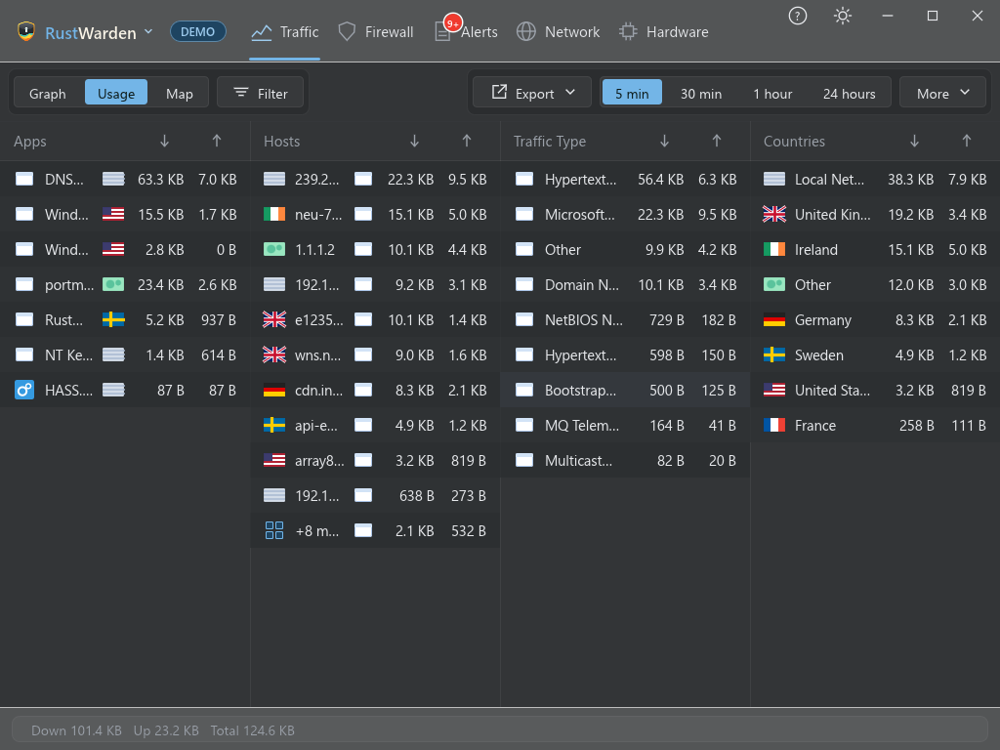

- Live traffic graph per app, host, traffic type and country, with a selectable time range.
- Table columns (Firewall, Live Connections, DNS Log, Destination Rules, Network Scanner) can be resized by dragging the borders in the header; the window can be resized from any point on its outer border.
- Interactive world map: bubbles per country, nearby ones cluster when zoomed out, hover tint and click-through to a detail popup.
- Country names and flags, a "Home" marker, and a filter panel (direction, scope, app, company/ASN).
- ASN / company lookup (Team Cymru or a web API) and a whois / RDAP icon beside every IP.
- Usage list view with CSV export (opens in Excel).
- Windows services are separate programs: traffic from svchost.exe is split by the service that sent it (for example "Windows Update (wuauserv)"), and the app info popup shows the service and the parent process that started each program.
- Alert pins on the traffic graph show where alerts happened (orange for important); click one for the details. A Display menu picks which alert types appear.

### 🛡️ Firewall: your firewall, simplified

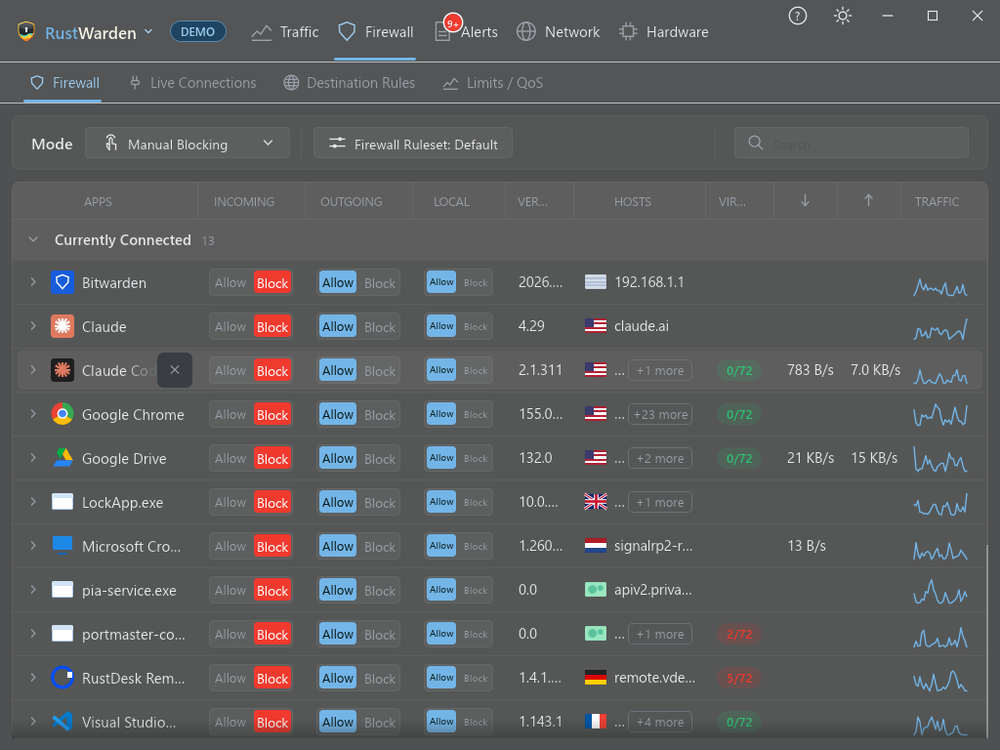

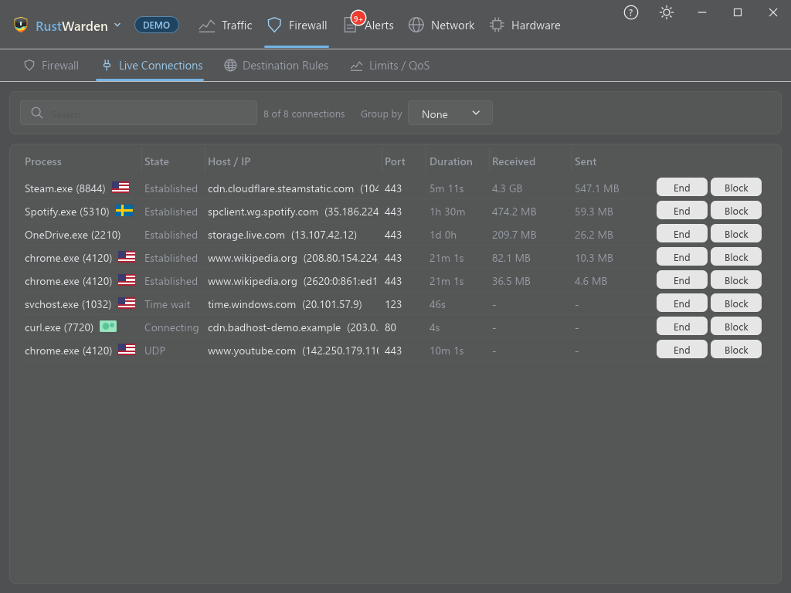

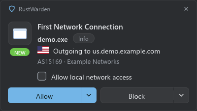

- Every program with network access in one list: allow, block incoming, block outgoing, or Block All.
- **Prompt** mode prompts you the first time a program reaches out. **Prompt for** (Firewall tab Mode menu, or the tray menu's slide-out) limits how long it stays on: Always (default), 10 or 30 minutes, 1 or 2 hours. When time is up the previous mode returns; the allow and block rules from your answers stay.
- A **ping** (ICMP) blocked by Prompt asks once, as "Ping (ICMP)": Windows sends pings from the kernel, so it can't say which program sent one, and allowing it lets every program ping. It adds two outbound ICMP rules (IPv4 and IPv6) that "Restore firewall defaults" removes. Blocking it does nothing, as pings are already stopped.
- The row under the mouse on the Firewall tab stays put while the pointer is on it (new apps and re-sorting happen around it, and the table scrolls to compensate when rows appear above it), so a click never lands on a different app.
- Changing the firewall mode shows "Applying…" with a spinner on the Mode button while Windows Firewall is updated.
- **Block after N minutes**: the Prompt prompt (Allow, block after 5/10/20/30/60 min) and the Firewall tab (right-click an Allowed chip, or the app popup menu) can schedule a block. Pending blocks are saved with their start time, so they carry on across a restart (one that came due while closed applies at startup); changing that direction by hand cancels it. An app with a block waiting shows an orange hourglass beside its name on the Firewall tab (hover for the time), and its info popup has a "Blocks" line with the time and how long is left, with a "Block now" button to skip the wait.
- **Firewall rulesets**: switch between rule sets safely; rules are parked and restored, never lost. The Firewall tab's "Firewall Ruleset: <name>" button opens Settings > Firewall, scrolls to the rulesets card and flashes it, where you switch, create and delete rulesets. The Mode box on the same bar has a Disabled entry (below a separator) that turns the firewall off, and the status banner sits at the top of the page.
- A separate **Local** Allow | Block control per program for private, link-local and multicast traffic.
- **Windows section**: locked Windows rows (core services, the kernel) are grouped under their own Windows header instead of mixing with your apps. Apps with no recent connection show "No connections recently" in the Hosts column.
- **Windows services** can be blocked on their own, in either direction, for services that have their own identity. Core services (RPC, DHCP, DNS Client, the firewall itself and similar) are locked, and a shared svchost.exe host is not blocked as a whole.
- App info popup: a compact solid card with path, version, publisher, signature and alert history (Info/Alerts switch), plus VirusTotal, quick allow/block and More (hide, Incognito) buttons. Hide apps you don't care about.
- **Export and import rules and settings** (Settings > Other > Backup): saves the programs you have blocked, your destination rules and all your settings to a JSON file, and reads one back. The password is left out, and tokens and webhook addresses stay encrypted for your Windows user, so they come back on the same account. Settings are applied key by key: ones the file lacks keep their value and ones this version can't read are skipped, so files from older or newer versions import without failing (Demo/Live mode and window position are not changed). Rules are named after the app, so this is how to keep them across a reinstall or a rename. Importing shows a summary first, applies only what differs from now (like clicking the chips on the Firewall tab) and never removes anything. Works in Demo mode too.
- Block All also covers programs another firewall app had allowed, and the firewall mode survives a restart.
- **Rule drift check**: RustWarden remembers its rules between runs. If one has been removed or changed outside RustWarden (by another tool, a script or by hand in Windows Firewall), including while RustWarden was closed, the next start raises a "Firewall rule monitor" alert naming the missing, altered or added rules, and writes the full list to `%LOCALAPPDATA%\RustWarden\rustwarden.log`. Each change is reported once. Live mode only; Demo mode has no real firewall to drift.
- **Destination rules** (Firewall > Destination Rules tab, also reachable from the RustWarden menu): block a program, or allow it to reach *only*, a domain (`*.example.com` covers the name and everything below it), an AS number (`AS15169`) or a country (`DE`, or pick it from a flag list as you type). For one program or, for Block, for all. Windows Firewall only filters by address, so RustWarden turns each rule into the address ranges it can find and keeps them current: a domain is what this PC has looked up for it (remembered for two weeks), a country comes from your offline country database, and an AS number from the free DB-IP ASN database, which is downloaded only when you press its button. Long lists are split across several rules. The local network, gateways and DNS servers are never blocked, "Only allow" is refused for "any program", and "Only allow" a domain waits for the first lookup before it starts blocking the rest. Limits: a program's first connection to a server it has not looked up yet can fail once, addresses shared with other sites (CDNs) are shared by the rule, and programs using their own encrypted DNS are not seen. The rules are RustWarden's own, and "Restore firewall defaults" removes them with the rest. Needs administrator rights; works in Demo mode with sample data.
- **Block by domain** (Driver mode, Firewall > Destination Rules, below the table): block a domain and everything under it (`example.com` covers `www.example.com`) for every program on this PC, something address-based rules can't do for shared servers. The driver drops the DNS lookup and the start of the HTTPS connection (the server name in the TLS hello). Add domains by hand, or press *Import list* to download a hosts-style or one-domain-per-line list from an https address you choose (nothing is downloaded until you press it; the list is kept in RustWarden's data folder and *Remove list* deletes it). Limits: programs using DNS-over-HTTPs together with Encrypted Client Hello, and QUIC (HTTP/3), can slip past. "Restore firewall defaults" clears the rules and list. Demo mode shows sample rules.
- **Live connections** (Firewall > Live Connections): every open TCP connection with its program and PID, state, remote host and port (names come from the DNS log) and bytes received and sent. Each row shows the remote country flag after the program, the host or IP and the port in separate columns, and how long the connection has been open. Click a column header to sort (again to reverse), use **Group by** (Process, State or Country) for collapsible groups, and search. Then **End** a connection (IPv4 only, since Windows has no call for IPv6) or **Block** its remote address in both directions with a RustWarden firewall rule that "Restore firewall defaults" removes. Byte counts and both buttons need administrator rights (the counts start when RustWarden first sees a connection). Works in Demo mode with sample data.
- **Bandwidth limits** (Firewall > Limits / QoS, also in the RustWarden menu): cap how fast a program can *upload*, for example Dropbox at 2 Mbps. Windows enforces it with a QoS policy (`New-NetQosPolicy`), so nothing runs in the background and no driver is involved. Pick the program, type a rate in Kbps or Mbps and press Set limit (setting a program again changes its limit); the switch in each row turns a limit off without losing it. Limits are named `RustWarden QoS <id> <program>`, are re-checked every minute (a policy removed by hand comes back), and "Restore firewall defaults" and `rustwarden --remove-all-rules` remove them all. In Normal mode Windows has no user-mode way to cap downloads, so only uploads are limited. In **Driver mode** (Settings > Other > Advanced > App mode) a Direction dropdown appears (Upload, Download, or Upload & Download, each with its own rate) and the WinDivert driver enforces the cap: it works over a VPN, and is paced per program across all its connections. Only the limited program's own connections go through the driver; everything else, including a VPN's tunnel, is left alone. A new connection is picked up within about a tenth of a second, so a very short burst at the start of a fast download can get through before the cap takes hold. If Windows Firewall starts dropping the packets the driver sends on (for example with a strict default-deny firewall), the engine switches itself off within seconds and the limit says why, instead of cutting your connection; its start, stop and a counter line every 30 seconds go to `engine.log` in the data folder. If the driver isn't ready, uploads fall back to the QoS policy and downloads say why they aren't limited; switching back to Normal mode returns everything to QoS. A connection that was already open when the engine started is found for TCP, but an open UDP/QUIC stream is limited once it reconnects. **Priority** (dropdown in the form, High / Normal / Low): High and Low programs can leave both rates empty (or 0). Windows marks their uploads with a DSCP tag (High = EF, Low = CS1) through a RustWarden QoS policy, which helps if your router or Wi-Fi honours it (Normal and Driver mode). In Driver mode, enter your line speed (Settings > Other > Line speed, Mbps up and down) and the programs listed in Limits / QoS share it: High is never held back and goes first, Normal gets what High leaves, Low what both leave (never less than 10% / 5% of the line). Programs that are not listed are not touched, so they are not part of the sharing. Needs administrator rights; critical Windows programs can't be limited. Works in Demo mode with sample limits.
- **VPN kill switch** (Settings > Privacy > VPN, administrator): while a VPN is up, everything except your local network and the VPN's own server is blocked on your real network cards, so nothing can leave outside the tunnel; if the VPN drops the block stays and the internet is cut until it is back. A VPN such as PIA only creates its adapter when you press Connect, so the switch arms itself the first time it sees a VPN connected, and learns the VPN's servers from the host routes the VPN client adds (it remembers them). "Let the VPN connect" opens the network for two minutes to reach a new server. Turning it off, closing RustWarden or Restore firewall defaults lifts it.
- **Block DNS-over-HTTPS resolvers** (Settings > Privacy > VPN, off by default): blocks HTTPS and DNS-over-TLS (ports 443 and 853) to well-known public resolvers (Google, Cloudflare, Quad9, OpenDNS, AdGuard, NextDNS and others), so browsers with private DNS fall back to the system resolver, where the DNS log and domain blocks can see lookups. Plain DNS is not touched.
- **QUIC fallback** (Driver mode, driver installed): for the programs you list (for example chrome.exe), UDP port 443 is blocked, so they use HTTPS over TCP, where the server name is readable for Block by domain and the host names. It is a plain per-program firewall rule, so it costs nothing per packet.
- **End a UDP flow** (Driver mode, driver installed): Live Connections also lists UDP flows (QUIC, voice, games) seen by the driver; **End** drops the flow's packets for 60 seconds, since UDP has no connection to close.
- If a block ever locks you out, see [Rescue](README.md#rescue-remove-every-rustwarden-firewall-rule).

### 🚨 Alerts and log analysis

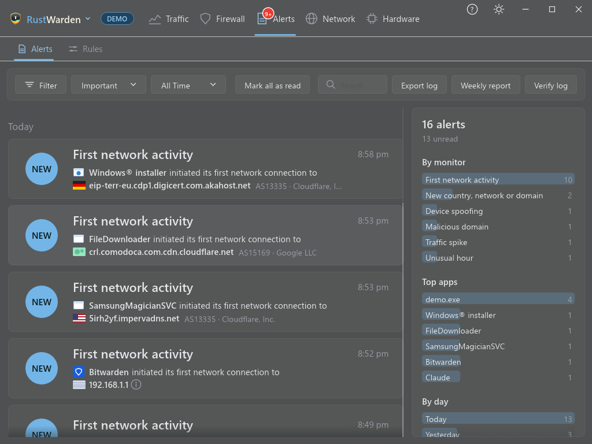

- Every desktop popup (alerts, Prompt, Malicious IP) looks like a Windows 11 notification and is built from one shared kit. Prompt prompts are a solid card: a solid card with the app, the host and a VirusTotal score, and split **Allow** and **Block** buttons whose chevrons open menus (block after 5 to 60 minutes; block all, incoming or outgoing). They slide in, never take focus from what you are doing, and sit in the free part of the screen next to the taskbar, wherever it is. The alert and Malicious IP popups use the same card, header and buttons (the Malicious IP one has a red edge and a red Block button) and stack in the same corner: threats nearest it, then Ask prompts, then alerts. Settings > Personalise picks the corner, how long alert popups stay and how many show at once.
- Desktop popups (off by default on a new install for every alert type, so new users aren't swamped; turn them on per alert in Settings > Alerts; Prompt's ask-to-connect popups are unaffected, and existing configs keep their settings), a searchable and filterable Alerts tab, tray badge for unread alerts. Clicking an Alerts card jumps to what it is about (the app, the device on the Scanner tab, DNS or Traffic); cards with nowhere to go aren't clickable. Clicking a desktop popup does the same (showing the window if it is in the tray), and its gear opens Settings > Alerts on that alert's entry. A sidebar beside the list charts the alerts currently shown (by monitor, top apps, by day), so it follows the search and filters.
- **Alert rules** (Alerts > Rules): decide what happens to an alert after it is raised. A rule has conditions, all of which must hold: an alert type, an app (picked with its icon), words in the text or target, a time window that may run past midnight (such as 22:00 to 07:00) and the days of the week. Its action is **Mute** (still logged, but no popup, event log entry or push, and it arrives read), **Escalate** (becomes Important with a popup), **Keep on this PC** (not sent to External Notifications) or **Limit repeats** (notify at most once per N minutes for the same alert type and app). The first enabled rule in the list that matches applies. Rules never stop an alert being recorded in the Alerts log. In Demo mode the test button in Settings > Alerts follows the rules too.
- Categories include new connections, app info changed, computer unlock, new user accounts or scheduled tasks, malicious IP hits and more, each with its own switch.
- **Listening port monitor**: alerts when a program starts listening on a new TCP port below 49152, saying whether it listens on every interface, one network address or this PC only (it reads the TCP table, so it needs no administrator rights). The first reading only sets the baseline. Has its own switch in Settings > Alerts.
- **VPN DNS leak check**: while a VPN tunnel adapter is up, alerts when another adapter still uses public DNS servers that are not the VPN's own, since Windows may send name lookups to those and around the tunnel. A router's private DNS address isn't flagged, and adapters whose name matches an ignore list (VMware, VirtualBox and vEthernet by default, editable in the alert's settings) are skipped, since bridged virtual machines never use the VPN. Has its own switch in Settings > Alerts; no administrator rights needed.
- **Reinstall default plugins**: Settings > Plugins shows one line with how many built-in plugins are uninstalled and a "Reinstall default plugins…" button, which opens a dialog to tick which ones to bring back.
- **Prometheus metrics plugin**: the metrics endpoint is now the built-in "Prometheus Metrics" plugin (Settings > Plugins, with its port on its settings page) instead of a General setting. It serves on 127.0.0.1 only while the plugin is on; a setup that had it switched on keeps it on, on the same port.
- **UPnP Port Forwarding plugin** (built in, adds a Port Forwarding sub-tab to Network): for when you can't reach the router's own settings. Press "Find my router", type the port on this PC (say 80), and RustWarden asks the router over UPnP to open a random public port that leads to it, showing the public address and port with a "Copy address" button. Mappings are named "RustWarden: <description>" on the router, listed on the tab and removable one by one or all at once. It warns when the router's address is not a public one (shared provider address), when a forward would not work from the internet. Works in Demo mode against a made-up router.
- **Cloudflare Tunnel plugin** (built in, adds a Cloudflare Tunnel sub-tab to Network): downloads Cloudflare's `cloudflared` (a pinned version, only kept if its SHA-256 matches) and runs a tunnel while RustWarden does, stopping it when RustWarden closes. Sign in with a tunnel token from the Cloudflare dashboard, or use "Log in with Cloudflare" (cloudflared opens the browser) and let it create the tunnel and a DNS record for the hostname you give. The sign-in path has not been tried against a real Cloudflare account yet. Demo mode pretends to run.
- **Block an app by clicking it**: RustWarden menu and tray menu > "Block an app by clicking it". The cursor becomes a +, the window under it is tinted, and clicking it asks to block that program in both directions (Esc or a right click cancels; a banner at the top of the screen says so). Any program can be picked, including Explorer and the taskbar. The rules are RustWarden's own, so they show on the Firewall tab and go with "Restore firewall defaults". Works in Demo mode (it only says what would be blocked).
- **First-run wizard**: a fast setup on a new install and once after the update that adds it (Skip setup always works). Four short steps: Live or Demo mode, the firewall mode (Manual Blocking, Prompt or Block All, confirmed when you finish), a pointer to Settings > Alerts (a new install starts with every alert off), and the databases for the features you pick. On the Dev update channel, Settings > Other > Updates > Run wizard opens it again.
- **Database downloads**: Settings > Countries & Network > Downloads (and the wizard) list the country, city and ASN databases one line each, with their size and status (the save location on hover). Download, Update or Update all asks first in a short popup (source db-ip.com, free Lite editions, CC BY 4.0, and the total size), and one progress bar, weighted by size, covers the whole batch. DB-IP publishes no checksums, so each file is unpacked beside the old one and only used if it opens as a database of the right kind and holds data.
- **Public IP address monitor** (off by default because it goes online): turn it on in Settings > Countries & Network > Public IP address. Every ten minutes RustWarden asks a web service of your choice (https, `api.ipify.org` by default) for this PC's address and raises a "Public IP address" alert when it changes, naming the ISP too when it changed and an AS lookup is switched on. Only a bare IP address is accepted as the answer. The first reading only sets the baseline. Has its own alert switch in Settings > Alerts.
- Monitors for new Windows user accounts, scheduled tasks, trusted root certificates, startup entries (Run keys and Startup folders) services or drivers, and apps starting to use the microphone or camera (read from the Windows privacy log). Like the hosts file, DNS-server and proxy monitors, each has its own switch.
- The alert log is tamper-evident: each entry is hash-chained to the one before it. The **Verify log** button on the Alerts tab, or `rustwarden --verify-alert-log` from a terminal, reports the first entry that was edited or removed. Entries from before this version are counted but cannot be checked. Clearing history never touches alerts, and removing the newest entries is not detectable.
- Export history: the **Export log** button on the Alerts tab saves every alert, and **History** on the Traffic tab saves the last 30 days of per-app traffic. Name the file `.json` for JSON; anything else gives CSV. Both are written locally and only when you click.
- Weekly summary (off by default): the **Weekly report** button on the Alerts tab shows the last seven days as bar charts (traffic per day, busiest apps, alerts by kind, ping averages) plus counts: busiest apps, new hosts and countries, alerts by kind, blocked connections, quota events, and ping averages. Turn on "Send a weekly summary" in Settings > Plugins > Notification Plugins to send it to your notification services on a weekday and hour you pick. The first one goes at the next slot, not when you switch it on, and nothing is sent unless a service is set up there. Demo mode shows a sample report and sends nothing.
- Forward alerts to the Windows event log and to Discord, Slack, Pushbullet, ntfy, Gotify and generic webhooks (External Notifications), with snooze support.

- **Beaconing detection** (Settings > Alerts): flags a program that contacts the same internet address at near-perfectly even intervals (between 15 seconds and an hour, at least 12 times in a row), the pattern of malware checking in with its controller. Many legitimate apps do this too; it is reported once a day per program and address. Programs you trust are picked from an app list (with their icons) on the alert's page (Settings > Alerts > Beaconing detection); they are not watched at all. Regular timing alone no longer reports: the series is scored from 0 to 100 on the size of its contacts (small, uniform ones score up; media-sized or over 1 MB/min downloads score down hard), whether the destination is a known media / CDN domain (live-video.net, googlevideo.com, cloudfront.net and others, editable), the program (unsigned, few destinations, or a browser with many), and how rare the destination is. The alert says why it scored high. Timing needs a minimum observation window and jitter limit; all limits are in Settings > Alerts. An optional domain next to the picker ignores only that program's contacts with that domain (stored as `program@domain`, such as `chrome@live-video.net`).
- **DNS tunnelling detection** (needs the DNS log): flags many long, random-looking lookups under one domain in five minutes, the way data is smuggled out through DNS.
- **Rogue DHCP server** (Driver mode, driver installed): alerts when more than one server answers DHCP on the network, which can hand your PC a wrong gateway or DNS server. It sees the answers to your own PC's requests, so it checks when your lease is obtained or renewed. Servers are tracked per network adapter, so VMware's, Hyper-V's and VirtualBox's own DHCP services on their virtual adapters don't count as rivals to your router (a status note only, unless you turn on watching virtual adapters). A second server on one adapter is critical when it hands out a different gateway or DNS server, a warning otherwise, and the alert names the adapter and what each server offered. Trusted servers (an address, or `adapter name=address`) are skipped.
- **TLS fingerprint check** (Driver mode, driver installed): reads the TLS ClientHello of each new HTTPS connection (JA3 and JA4) and alerts when a program named like a web browser opens connections with the same fingerprint as a command-line tool such as curl or Python. A hello that spans two packets is skipped.

### 📏 Data quotas
- Per-app and global quotas (Settings > Quotas): a limit in MB or GB per day, week or month. Local network traffic is not counted, and the counters come from the stored traffic history, so they survive restarts and follow the calendar when a period rolls over or the clock changes.
- An alert at a warning percentage you choose (80% by default) and at 100%, through the usual alert settings: Alerts tab, tray badge, event log and External Notifications.
- At 100% a quota can do nothing more, alert only, or block the app through the firewall (needs administrator rights). Two softer actions cap the app's upload rate instead (a Windows QoS bandwidth limit, see Firewall > Bandwidth Limits): **Limit upload at 100%**, or **Limit upload at warning, block at 100%**, which slows the app from the warning level and only blocks at the limit. The cap is the "Upload cap" row (Kbps), shows in the Bandwidth Limits tab like any limit, is lifted when the period resets or the quota changes, and is skipped if you already limited that program yourself. The block is lifted automatically when the period resets, or if you raise or remove the quota; a block you set yourself is never touched.
- A progress bar in the app info popup shows how much of the app's quota is used. Demo mode shows sample quotas.

### 🧭 Behaviour baseline
- Optional (Settings > Alerts, off by default, needs administrator): each program's usual countries, networks, active hours and daily volume are learned from the last 14 days of stored traffic (the first 7 days only learn).
- Alerts when a program contacts a new country or network, moves far more data than usual in a day, or is busy at an hour it is almost never active. Each alert says why.
- "Mark as normal" on a graph pin or on the alert's Log card teaches the baseline, and repeats are throttled. Purple pins on the traffic graph mark these alerts.

### 🔎 DNS Log

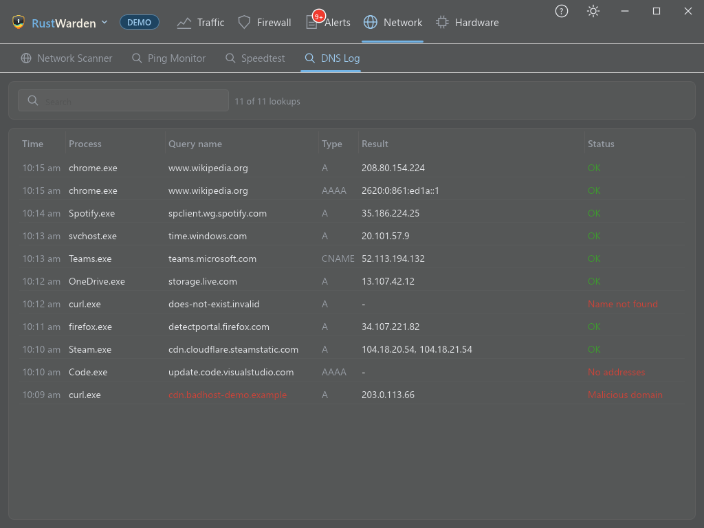

- Network > DNS Log lists every lookup each program makes (time, process, query name, type, result addresses, status), with a search box over all columns. Failed lookups show their status (for example "Name not found").
- Read from the Windows DNS Client's ETW events (Live mode, administrator rights), so nothing about your DNS settings is changed. Programs that resolve names themselves (browsers with DNS over HTTPS) don't appear.
- Stays on this PC. Settings > General > History turns it off and sets how long it is kept (7 days by default); programs hidden under Privacy are left out.
- Optional malicious-domain alerts (Settings > Malicious IP protection, off by default because it downloads): the same download rules as the IP lists, a hosts file or name list, by default a keyless mirror of abuse.ch URLhaus. A program looking up a listed name (or a subdomain of one) raises a "Malicious domain" alert once, and the name shows red in the log. It only warns: nothing is blocked and your DNS settings are never changed.

### 🕵️ Malicious IP protection

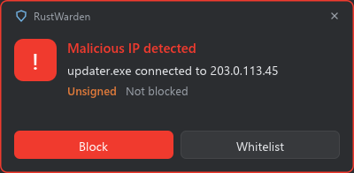

- Off by default because it downloads: turn it on in Settings > Malicious IP protection. Downloads public botnet and threat lists (Feodo Tracker and IPsum by default, editable) on a schedule.
- Programs connecting to a listed address are blocked and reported; review, unblock or whitelist from Settings.
- Lists are checked before use: https only, 20 MB at most, and one that is binary, a web page, mostly not entries, or over its size limit (200 000 addresses, 1 000 000 domains) is refused. A refused or failed list keeps its addresses from the last good copy, and the cache is replaced atomically with the previous copy kept as a backup.
- Never blocked, whatever a list says: loopback and your local network, your gateways and DNS servers, and your Home Assistant host. They are left out and logged. Skipped and refused lists are written to `%LOCALAPPDATA%\RustWarden\lists.log`. (The malicious-domain lists only raise alerts, so they get the same download checks but nothing is blocked.)
- Lists are Live-only; Demo mode downloads nothing.

### 🔬 VirusTotal integration
- Hash lookups, manual or automatic, with a score bubble on connection banners and Prompt prompts. Only the file's SHA-256 is sent.
- Each program is checked once per file hash: a result, including "Not found", is kept and never looked up again at startup or on a timer. A new version of a program has a new hash, so it is checked once more.
- A program VirusTotal has never seen shows "Not found" and stays that way. To upload the file itself, right-click the row (or use the ▾ menu in its info popup) and choose "Upload to VirusTotal…"; a dialog explains that the file's contents are shared with security vendors and may become visible to others, and only that one file is uploaded once you confirm. RustWarden never uploads on its own, even with automatic scanning on. Uploaded files are polled until the report arrives (files over 650 MB are skipped; VirusTotal takes nothing larger), and each upload is written to `%LOCALAPPDATA%\RustWarden\rustwarden.log`.
- Live mode only: Demo mode has no file hashes or API key to look up.

### 📡 Network scanner

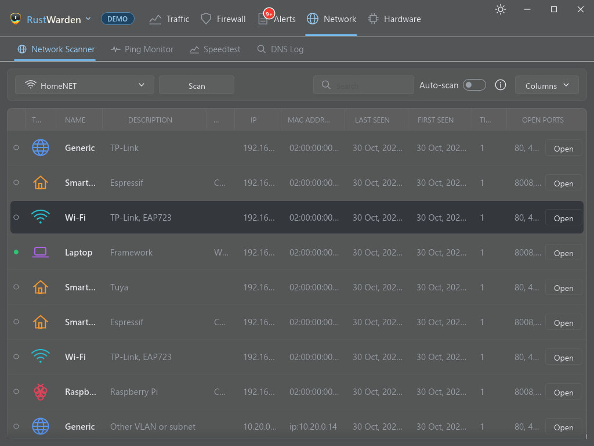

- Discovers devices on your adapter, with vendor lookup, first/last seen and how often each came back online.
- Per-device port scan, saved results, and an Open menu for discovered services.
- Click a device for a details dialog (status, addresses, open ports, rename).
- Sortable, resizable columns that you can show or hide; the layout is remembered.
- Optional auto-scan.
- **Other VLANs and subnets** (Settings > Network scanner, on by default): ARP cannot cross a router, so the scan also pings the .1 and .254 of the /24 networks in your /16 (and, on 10.x, the first /24 of every 10.x /16) and then every host of those that answer. Those devices show "Other VLAN or subnet" instead of a vendor and are identified by IP, not MAC. Hosts that block ping are not found, and scans take longer; switch it off for a local-only scan.
- Three scanner alerts, each with its own switch (Settings > Alerts) and delivered to the Alerts tab and External Notifications: a **never-seen-before device** joined (mark devices **Trusted** in their details), **possible ARP spoofing** (an IP now has a different MAC, or one MAC answers for several IPs; a gateway change is always Important), and a **known device returned** after N days away. Alerts include the Home Assistant name and area when the device is matched. The first scan of a network only learns what is there.

### 🧩 Kernel & System split
- Windows reports all kernel-mode networking as one program, "NT Kernel & System". RustWarden splits that row by service, told apart by port: **SMB file sharing**, **NetBIOS**, **Device discovery** and **HTTP.sys listeners**, plus "Other". Each row shows its own remote hosts. Windows doesn't say which driver or app caused kernel traffic, so the port is the only evidence.
- On by default; switch it off in Settings > General. Applies to new traffic and needs administrator rights. The rows can't be blocked, like the original. Works in Demo mode.

### 🚀 Speedtest

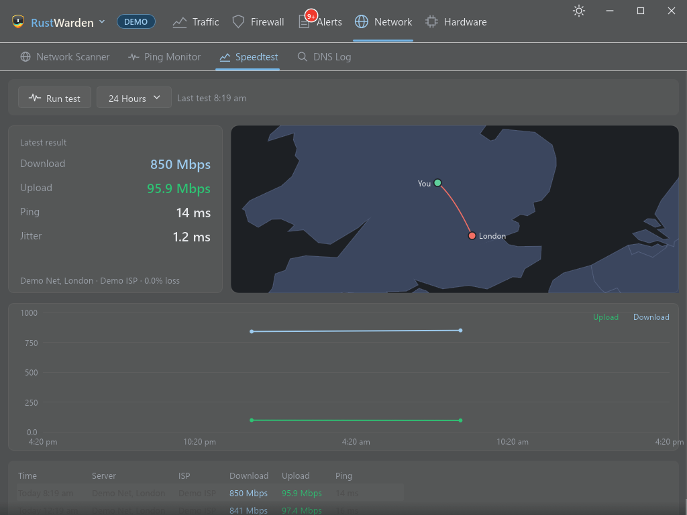

- A **Speedtest** sub-tab under **Network** (switch it on in Settings > Network scanner): press **Run test** to measure download, upload, ping and jitter, with a history chart and a list of past tests. Demo mode shows sample results.
- While a test runs, a **speedometer** swings with the live speed (download, then upload), a graph draws the speed over time, and a **map** shows a line from you to the test server. The map needs a GeoIP database (a city one is most exact); without it the map says the location is unknown.
- Speedtest.net has no public API, so this uses Ookla's own `speedtest-cli`. It is downloaded only when you press the button and accept Ookla's license in the warning dialog, and checked against a pinned SHA-256. Running as administrator, it is kept in `Program Files\RustWarden\speedtest`; otherwise in the data folder. Nothing runs automatically unless you set a schedule in Settings.

### 📍 Ping Monitor

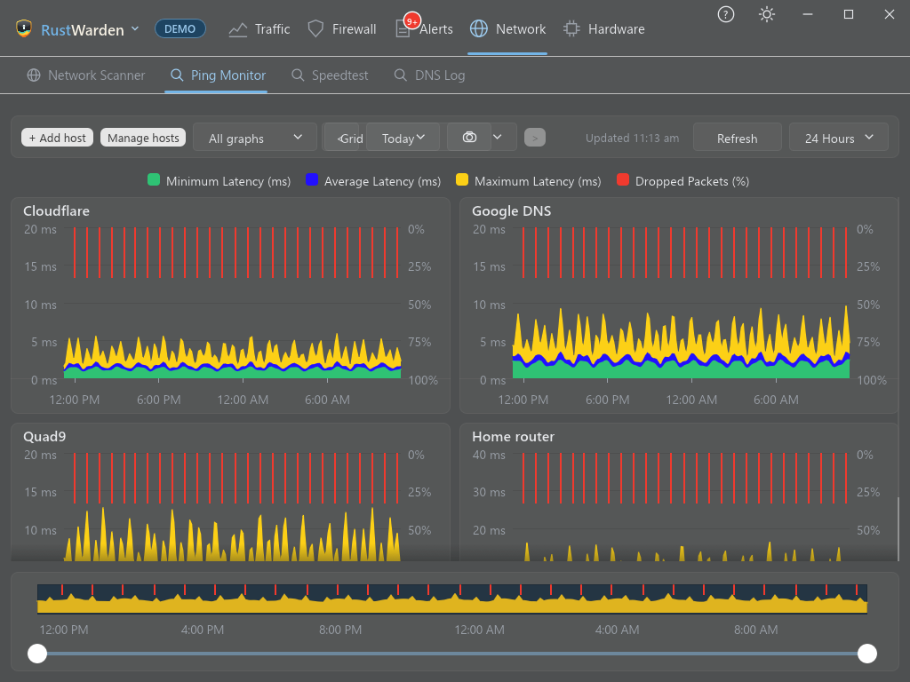

- A **Ping** sub-tab under **Network** (switch it on in Settings > Network scanner): add hosts, and each is pinged every 30 seconds.
- Latency charts with selectable ranges and side by side, stacked or grid layouts; history is kept for 30 days in RustWarden's own database. Demo mode shows sample charts.

### 📈 Hardware resources

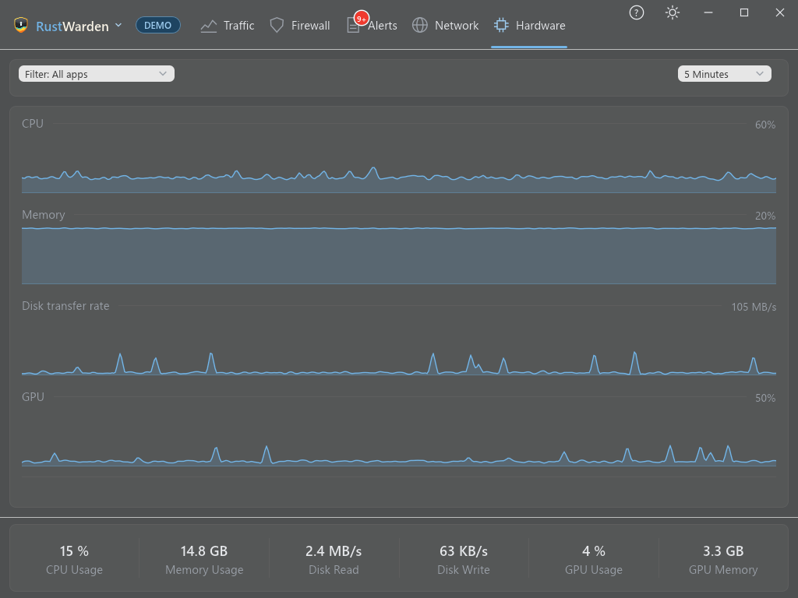

- CPU, memory, disk and GPU history with gaps shown honestly and configurable retention.
- Filter by program to chart one app's CPU, memory and disk usage over time. Demo mode has sample history and programs too.

### 🔌 Plugins
- **Settings > Plugins** replaces Integrations, with two sections: **System Plugins** (Home Assistant, VirusTotal, ping and similar) and **Notification Plugins** (Discord, Slack, Pushbullet, ntfy, Gotify, webhook).
- **Create a Plugin** (Settings > Plugins) opens the plugin walkthrough, [plugin-sdk/CREATING_A_PLUGIN.md](plugin-sdk/CREATING_A_PLUGIN.md), on GitHub.
- Third-party and private plugins are `.wasm` files that run in a sandbox. By default a plugin can only add tabs and a settings page; anything more is an opt-in permission you tick when you approve it, like phone app permissions. A plugin has no file or network access of its own: it can reach only the websites its manifest lists, and only its own database tables.
- Plugin files live in `Program Files\RustWarden\plugins`, which only administrators can write. Each file must be approved once; a changed file asks again. Unapproved or switched-off plugins never run. Remove deletes the file and, if you tick it, the plugin's settings, saved secrets and data.
- A plugin's saved settings are stored per plugin under `%APPDATA%\RustWarden\plugins`, and its secrets are encrypted with Windows DPAPI for your account, like every other token.
- **Built-in plugins** ship inside RustWarden.exe and start from the switch on the Plugins page: Discord, Slack / Mattermost / Rocket.Chat, Pushbullet, ntfy, Gotify and a generic webhook (Notification Plugins), and Ping Monitor, Home Assistant, VirusTotal, Speedtest, Prometheus Metrics, UPnP Port Forwarding, Cloudflare Tunnel, Shodan InternetDB and AbuseIPDB (System Plugins). Settings from earlier versions are carried over automatically.
- Writing your own plugin: see [PLUGINS.md](PLUGINS.md) and `plugins/example-hello`. The Discord, Slack, Pushbullet, ntfy, Gotify and webhook notifiers are also available as plugins; they need the "alerts.read" permission to receive alerts.
- Every integration is a plugin: the built-in ones listed above, including Speedtest (Ookla's CLI, downloaded only when you press the button).
- **Shodan InternetDB** (a built-in plugin, no key): look up an address, or this PC's public address, to see its open ports, known vulnerabilities and host names as the internet sees them. Only the address you ask about is sent.
- **AbuseIPDB** (a built-in plugin, free API key): look up how often an address was reported for abuse. With the "alerts.read" permission and the automatic switch on, the public addresses in alerts are scored once a day and shown in the app when the score reaches your level.
- **Home Assistant** (a built-in plugin): matches scanned devices by MAC and shows their HA name, area and a coloured device-type icon, with links to the HA device page.
- Tokens, API keys and webhook addresses are stored encrypted with Windows DPAPI for your account.
- **Prometheus metrics** (the built-in "Prometheus Metrics" plugin, off by default): switch it on in Settings > Plugins and scrape `http://127.0.0.1:9877/metrics` (the port is configurable). It listens on this computer only, refuses requests whose Host is not localhost, and reports 24-hour internet traffic, blocked connections, alerts by kind and the busiest ten apps. It makes no outbound connections. Demo mode serves sample numbers.

### ⚙️ Everything else
- Optional tamper protection (Settings > General > Security, off by default): a password, stored hashed and DPAPI-sealed, is asked before opening Settings, Exit and Restart. It deters casual changes on shared PCs; stopping the service from services.msc or `sc stop` also asks for it (an administrator can still end the process, but the service restarts itself a second later). Running a newer RustWarden.exe than the installed service's copy offers to update the service first.
- RustWarden reopens on the tab and sub-tab you were on (for example Network > Ping, or Alerts > Rules) and on the Traffic tab's Graph, Usage or Map view, along with the time range and window position it already remembered.
- System tray with hide-on-close (its menu has an Alerts item that opens the Alerts tab, and a Firewall submenu to pick a mode or Disable the firewall), Windows service install, start with Windows.
- Incognito and hidden-app privacy controls.
- **Peer-to-peer guard** (Settings > Privacy > P2P, off by default): spots programs that exchange data with many internet addresses no website lookup ever named, which is what torrents look like, and lists them. Switch a program on there and it is blocked completely, in both directions, whenever no VPN adapter is connected, and let through again when one is. It is a guess from traffic patterns (nothing leaves your PC), the block covers the whole program, and it needs Live mode with administrator rights. Its firewall rules are tagged RustWarden's and removed by "Restore firewall defaults". Demo mode shows sample programs.
- A Windows 11 look: soft cards, a teal accent you can change in Settings > Personalise (the Windows colour grid, a custom colour, or "Use Windows accent colour", which follows Windows live and also colours the traffic graph), Mica or acrylic backdrop, light and dark themes (on by default RustWarden follows Windows' own light/dark mode and the Windows accent colour, and switches live when Windows does; turn "Follow the Windows theme" off in Settings > Personalise to choose one, or click the theme button at the top right to go through Follow Windows, Light and Dark), UI scale from 1.0x to 1.5x, and a setting for how opaque popups stay.
- The Traffic tab shows download above and upload below a centre line, with Download, Upload and Total blocks and a WAN/LAN split bar underneath; a brush over the history picks the span. The totals and timeline fold down to a compact bar (the arrow remembers its state), and fold away by themselves in the Usage and Map views.
- Demo mode with generated data, so you can explore without touching your system.
- Save snapshots of the current view.
- **Helper downloads always work** (Settings > Firewall > Advanced > "Let RustWarden's own downloads through the firewall", on by default): just before RustWarden starts one of its own helpers (`curl`, PowerShell, the speed test program) for an update, lookup or download, that helper is allowed online for ten minutes even if a rule blocks it. A block rule for exactly that program is switched off for the lease and back on afterwards (when it ends, when RustWarden closes, or at the next start after a crash); if the firewall blocks everything by default, a temporary allow rule tagged RustWarden is added and removed. Other programs' rules are never touched. Needs administrator rights.
- **Driver mode** (Settings > Other > Advanced > App mode, off by default): Normal mode needs no driver and is everything described above. Driver mode unlocks features that need packet-level access. Every such control (alerts, settings rows, Live Connections, Destination Rules and Limits / QoS options) is hidden unless Driver mode is on *and* the driver is installed, so nobody who doesn't want a driver sees a feature that needs one. It uses [WinDivert](https://github.com/basil00/WinDivert), an open-source packet driver with a Microsoft-accepted signature, so no test mode is needed. It is never bundled: *Download and install* fetches the official 2.2.2 release zip from github.com, checks it against a pinned SHA-256 and keeps only the DLL and driver file in `Program Files\RustWarden\driver`, where only administrators can change them; an older install in the data folder is removed and reinstalled there automatically the next time RustWarden runs as administrator (*Remove driver* deletes them and the service). **Microsoft Defender note:** Defender often flags WinDivert, because some game-cheat and bypass tools bundle it. RustWarden asks first, then adds a Defender exclusion for its driver folder only, and removes that exclusion again with the driver. If Tamper Protection refuses it, or Defender removes the files anyway, the card says so; allow the item under Windows Security > Virus & threat protection > Protection history and install again. Needs administrator rights. Demo mode simulates the install. **Network-condition simulator** (Driver mode, Firewall > Bandwidth Limits): the limit form also has *Add delay (ms)* and *Packet loss (%)*. They apply to every connection of that program in both directions, with or without a rate cap (leave the rate empty for none), to test how a program copes with a bad connection. Up to 5000 ms and 90% loss; the simulation switches itself off after 30 minutes (checked every minute) and a limit that was only a simulation is switched off with it. Rows show the added delay and loss next to the rate. **Packet capture** (Driver mode, Firewall > Live Connections): right-click a connection and choose *Capture this connection to a .pcap file*. The driver copies that connection's packets (nothing is held back) into a file in RustWarden's data folder, `captures`, that Wireshark opens. A banner above the table shows the packet count and a Stop button; a capture also ends by itself at 50 MB or 5 minutes. TCP connections only; the traffic is as it crosses this PC, so encrypted connections stay encrypted. Needs administrator rights. **Inbound scan alerts** (Driver mode, Alerts > "Inbound port scan and flood", on by default): the listener also watches incoming connection attempts. One address trying 12 or more different ports on this PC within 10 seconds raises a *Port scan* alert, and 300 or more attempts in a second raises a *Connection flood* alert naming the busiest source; each is reported once per ten minutes. Nothing is blocked. **Force DNS** (Settings > Firewall > Advanced, Driver mode, off by default): enter a resolver such as `1.1.1.1` and every program's plain DNS lookups (UDP port 53, IPv4) are sent there whatever server they were aimed at, and the answers are made to look as if the original server sent them, which closes DNS leaks (a VPN's split setup, or a program using your ISP's resolver). Encrypted DNS isn't touched, and the resolver must be reachable on your normal connection. **Host names:** with Driver mode on, a listener (Settings > Other > *Learn host names from the driver*, on by default, nothing leaves your PC) reads the server name of new HTTPS connections (SNI) and DNS answers, so the Connections tab names more servers. Each server name is filed under the program that opened the connection, so on an address many sites share (a CDN) every program's traffic is named by the site it actually asked for, even when its own DNS is encrypted and another program's lookup named the address first; and the DNS Log also lists lookups made by programs with their own resolver, such as some browsers. Windows' own resolver is already logged, so those aren't doubled. Limits: encrypted client hello and DNS-over-HTTPS hide names; QUIC isn't read.
- Built-in updater: RustWarden menu > Check for updates (also checked automatically) installs new releases after verifying their SHA-256. Releases are read from this GitHub repo and each download is checked against a signed checksum. Settings > Other > Update channel switches between Release and Dev (alpha builds, with a warning); switching back to Release installs the latest release at the next check.
- File > About shows a picture of the project's own knowledge graph.
- User guide (https://rustwarden.github.io/RustWarden/): the ? button at the top right, "User guide" in the RustWarden menu (above About), and the "User guide" link at the bottom left of Settings open it in your browser.

## Clean up

RustWarden has no installer, so what it downloads stays on disk. Settings > Other > Backup > Clean up > Remove… deletes speedtest-cli, the GeoIP and ASN databases, the malicious IP and domain lists (after a warning), and switches off the features that used them. History, alerts, firewall rules and settings are kept.
