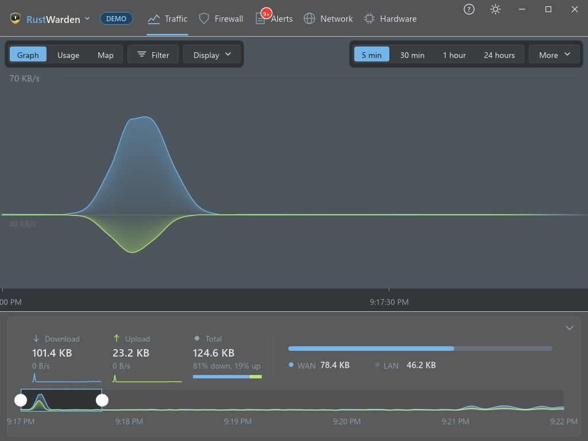

<div align="center">


# RustWarden

**See every connection. Block what you don't trust.**

A fast, native Windows network monitor and firewall front-end, written in Rust.


</div>



<sub>Screenshots are from Demo mode (sample data), so nothing here is from a real PC.</sub>

**RustWarden** is a native Windows network monitor and firewall front-end in a single small exe, written in Rust. It shows which programs talk to the internet, where the traffic goes and how much of it there is, and lets you allow, block or ask about each one with the Windows Firewall. It needs no driver, sits happily in the system tray, and has a Demo mode so you can try everything without touching your system.

> **How it was made:** by feel. I described what I wanted, a tireless pair programmer typed the Rust, and I kept steering until it compiled, looked right and behaved. It is a young project with more enthusiasm than ceremony, so try the firewall features in Demo mode first and keep the [rescue button](#rescue-remove-every-rustwarden-firewall-rule) in mind.

### What it does
- **See what is happening:** a live traffic graph and world map per app, live connections, a DNS log and a network scanner.
- **Stay in control:** allow, block or be asked about each program, destination rules, upload limits and data quotas.
- **Get warned, not buried:** alerts, malicious IP protection, VirusTotal scores and a behaviour baseline.
- **Watch your connection and PC:** speedtest, ping monitor and hardware history.
- **Fits your setup:** Home Assistant, Prometheus and webhook notifications.

See **[FEATURES.md](FEATURES.md)** for the full list.

### Built to be safe
- **Local first.** Anything that talks to the internet is off until you turn it on, and secrets are stored encrypted with Windows DPAPI.
- **Reversible.** Every firewall rule and QoS policy RustWarden creates is tagged as its own, and one button (or `rustwarden --remove-all-rules`) removes them all.

[Download](#download) | [Build from source](#build-from-source) | [All features](FEATURES.md) | [Rescue: remove all rules](#rescue-remove-every-rustwarden-firewall-rule)

---

## Rescue: remove every RustWarden firewall rule

If a block goes wrong and the app can't be opened, `RustWarden.exe --remove-all-rules` removes every Windows Firewall rule RustWarden owns (and undoes Block All), then exits. It opens no window, so it can run from a scheduled task:

```
schtasks /create /tn "RustWarden rescue" /sc once /st 00:00 /rl highest /ru SYSTEM /tr "\"C:\Program Files\RustWarden\RustWarden.exe\" --remove-all-rules"
schtasks /run /tn "RustWarden rescue"
```

Rules RustWarden doesn't own (Windows', other firewalls') are never touched. Rules RustWarden imported from another firewall app are handed back to it, not deleted. Each removal is written to `%LOCALAPPDATA%\RustWarden\rescue.log`, and the run's output shows in a terminal you started it from. Exit codes: 0 done, 1 some rules could not be removed, 2 not run as administrator (nothing was changed). Adjust the path to where `RustWarden.exe` lives. QoS policies are not covered because RustWarden doesn't create any.

## Download

Grab `RustWarden.exe` from the [latest release](https://github.com/rustwarden/RustWarden/releases/latest). A new release is published every night when there are changes, and a `RustWarden.exe.sha256` checksum sits beside it.

It is a single self-contained file: nothing to install, no Rust toolchain and no Visual C++ redistributable. Windows 10/11 is all it needs.

## Build from source

```powershell
git clone https://github.com/rustwarden/RustWarden.git
cd RustWarden
cargo run --release
```

Requirements: Windows 10/11 and a recent Rust toolchain (edition 2024).

**Run as administrator** for full Live mode: ETW traffic capture, firewall rules and service install need elevation. Without it RustWarden degrades gracefully and the header offers an "Install service" button.

Use **Settings > Other > Use demo data** to switch to Demo mode.

## Project layout

| Path | What lives there |
|------|------------------|
| `src/ui/` | Traffic, map, Firewall, Alerts, Network (scanner, ping and speedtest) and Hardware tabs |
| `src/live/` | Real data collection (ETW, firewall, hardware counters) |
| `src/destrules.rs` | Destination rules: rule model, storage format and address-range arithmetic (shared by Live and Demo) |
| `src/demo.rs` | Demo data backend |
| `src/plugins/` | Integrations: Home Assistant, Ping Monitor, Speedtest, VirusTotal, External Notifications, settings page |
| `assets/` | Logo, icons, flags, world map data, OUI vendor table |
| `.github/` | Release workflow (nightly build and publish) |

See [FEATURES.md](FEATURES.md) for the feature list and [changes.md](changes.md) for the full feature log.

## Acknowledgements

Inspired by the feature sets of other firewalls and network monitors. Not affiliated with any of them.
