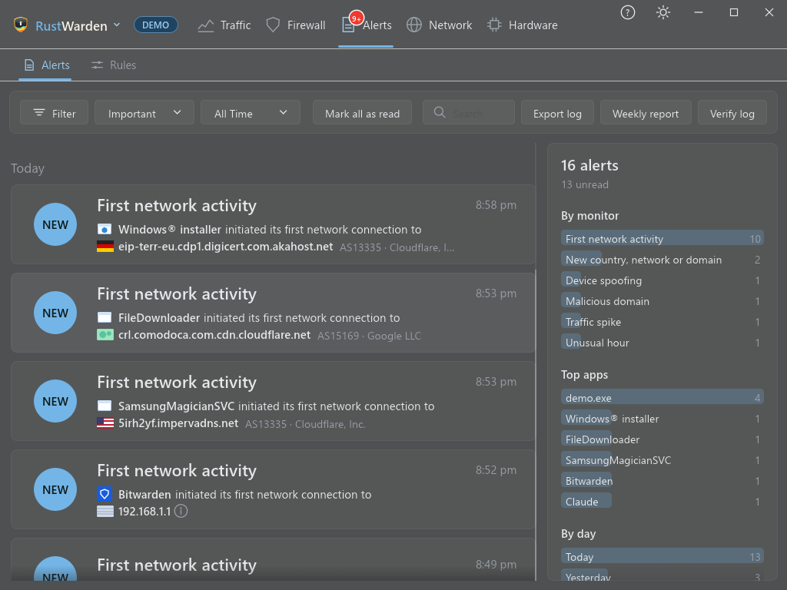

# Alerts

RustWarden runs a set of **monitors** that watch for things worth knowing about: a program connecting for the first time, a new device on the network, a changed hosts file, a malicious IP, and more than thirty others. Each finding is an **alert**.

Every alert is always **recorded** in the alert log. What else happens with it is up to you:

- a **desktop popup**,
- an entry in the **Windows event log**,
- a message through your **notification plugins** (Discord, ntfy, Slack and others),
- and whether it's **Important** or just a **Log** entry.

The [Alert types](alert-types.md) page explains every monitor, and [Alert rules](alert-rules.md) shows how to mute, escalate or limit alerts by condition.

## Setting up alerts

**Settings > Alerts > Alert types** lists every alert type on the left; types that are on have a green **ON** badge. Select one to set:

| Option | Meaning |
|---|---|
| **Main switch** | Whether this monitor runs at all |
| **Show desktop notification** | A popup on screen |
| **Send to the Windows event log** | Application log, source "RustWarden" |
| **Send to Notification Plugins** | Forwarded to every notification plugin that is switched on (greyed out until one is) |
| **Alerts level** | **Logs**: read by default. **Important**: unread by default, with its own "Important" section on the Alerts tab. |

Some types have extra options here, such as the beaconing ignore list or the "device returned after N days" setting. They are described on [Alert types](alert-types.md).

!!! info "A new install starts quiet"
    On a new install, the desktop popup is **off** for every alert type, so new users aren't swamped. Turn on the popups you want. Prompt questions aren't affected.

**Settings > Alerts > Options** has:

- **Send alerts to the Windows event log**: the master switch for event log entries.
- **Behaviour baseline**: see [Behaviour baseline](../protection/baseline.md).

### Testing

**Settings > Other > General > Send a test notification** shows a made-up Prompt popup, Malicious IP popup, or an alert of any type you choose. It records nothing and changes no firewall rule. Test alerts are delivered exactly as a real one would be, so they follow your alert settings and [alert rules](alert-rules.md).

## The Alerts tab

**Alerts > Alerts** is the alert log.

- **Search** across the text, program and target.
- **Filter** by category or monitor. **Clear filters** resets them.
- **Mark all as read** clears the unread count and the tray badge.
- **Snooze 1 h** pauses popups and notifications for an hour (**Unsnooze** ends it early). The tray menu has the same switch.
- A **sidebar** beside the list charts the alerts currently shown **by monitor**, **top apps** and **by day**. It follows the search and filters.

**Clicking an alert card** jumps to what it's about: the program on the Firewall tab, the device on the Scanner tab, the DNS log, or the moment on the Traffic graph. Cards with nowhere to go aren't clickable. Clicking a desktop popup does the same, and shows the window if it's in the tray. The popup's **gear** opens that alert type's settings.

Baseline alerts and [DNS tunnelling](alert-types.md#dns-tunnelling-detection) alerts have a **Mark as normal** button: on the alert card, on its pin on the Traffic graph, and on its desktop popup. For a baseline alert it teaches the [baseline](../protection/baseline.md); for DNS tunnelling it stops alerts for that domain. A message confirms it, and the button disappears once the alert has been marked.

## Exporting

**Export log** saves every alert. Give the file a `.json` name for JSON; any other name gives CSV. It's written only when you click, and only to the file you choose.

## Weekly report

**Weekly report** shows the last seven days:

- bar charts of traffic per day, the busiest apps, alerts by kind and ping averages;
- counts of new hosts and countries, alerts by kind, blocked connections and quota events.

To have it **sent** to you, switch on **Send a weekly summary** under **Settings > Plugins > Notification Plugins** and choose a weekday and hour. The first one goes out at the next slot after you switch it on, and nothing is sent unless a notification service is set up. Demo mode shows a sample report and sends nothing.

## Tamper-evident log

Each alert entry is **hash-chained** to the one before it, so editing or removing an entry breaks the chain.

- **Verify log** on the Alerts tab, or
- `RustWarden.exe --verify-alert-log` from a terminal,

reports the first entry that was edited or removed.

- Entries from before this feature existed are counted but can't be checked.
- Clearing traffic history never touches alerts.
- Removing only the **newest** entries can't be detected.

## Alert pins on the Traffic graph

Alerts also show as pins on the [Traffic graph](../traffic.md#alert-pins) at the moment they happened. Orange pins are Important alerts and purple pins are baseline alerts. **Display** on the Traffic tab chooses which types get pins.
