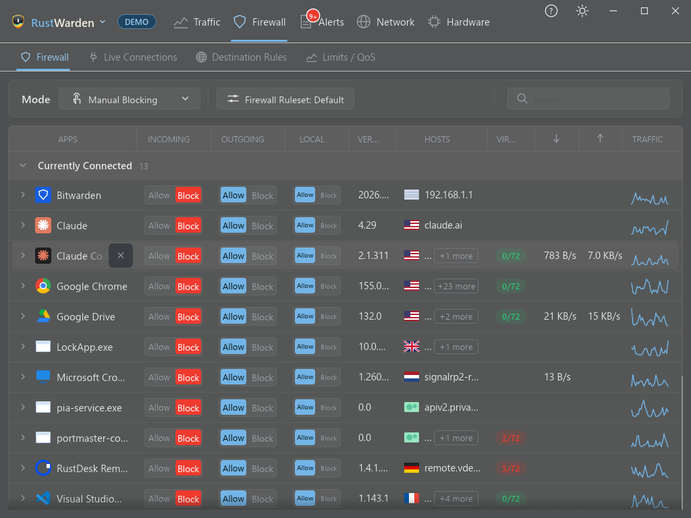
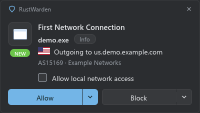

# The Firewall tab

The **Firewall** tab lists every program that has used the network and lets you decide what each one may do. RustWarden doesn't filter traffic itself: it writes rules into the **Windows Firewall**, tagged as RustWarden's own (see [RustWarden's own rules](../getting-started/concepts.md#rustwardens-own-rules)).

The tab has four sub-tabs:

| Sub-tab | What it is for |
|---|---|
| **Firewall** | Per-program allow and block (this page) |
| **Live Connections** | Every open connection right now. [Read more](live-connections.md) |
| **Destination Rules** | Block or allow by domain, country or network. [Read more](destination-rules.md) |
| **Limits / QoS** | Bandwidth caps and priorities. [Read more](limits-qos.md) |

!!! note
    Changing the firewall needs administrator rights and a readable Windows Firewall. If Windows Firewall itself is off, a banner says RustWarden's rules have no effect and offers **Turn on Windows Firewall**.

## Firewall modes

The **Mode** button on the toolbar (also in the tray menu under **Firewall**) chooses how RustWarden treats programs. While Windows Firewall is being updated, the button shows **Applying…** with a spinner.

| Mode | What happens |
|---|---|
| **Manual Blocking** | Everything is allowed. You block programs yourself. The gentlest mode and a good place to start. |
| **Prompt** | A program connecting for the first time is held and you're asked whether to allow it. See [Prompt](#prompt). |
| **Block All** | Almost every program is blocked in both directions. This also covers programs another firewall app had allowed. A banner shows while it's on, and **Undo Block All** puts everything back. |
| **Disabled** | Below a separator in the menu. Switches RustWarden's block rules **off** (they stay saved), so every program can use the network again. Windows Firewall itself is left as it is. |

The mode survives a restart.

### Prompt

In Prompt mode, a new program is stopped until you answer a popup:

The popup shows the program, the host it's trying to reach and its VirusTotal score (if [VirusTotal](../protection/virustotal.md) is set up). It has two split buttons:

- **Allow**. The arrow opens **block after 5, 10, 20, 30 or 60 minutes**: the program is allowed now and blocked automatically later.
- **Block**. The arrow chooses **block all**, **block incoming** or **block outgoing**.

Prompt popups stay until you answer them and never take focus from what you're doing. If several are waiting, the banner on the Firewall tab has a **Review** button that brings them all to the front.

**How long Prompt stays on.** **Prompt for** (Mode menu on the Firewall tab, or the tray menu) can be **Always** (the default), **10 or 30 minutes**, or **1 or 2 hours**. When the time is up, the previous mode comes back. The allow and block rules from your answers stay.

**Pings.** A ping (ICMP) stopped by Prompt asks once, as "Ping (ICMP)". Windows sends pings from the kernel, so it can't say which program sent one, and allowing it lets **every** program ping. Allowing adds two outbound ICMP rules (IPv4 and IPv6), which **Restore firewall defaults** removes. Blocking does nothing extra, because pings are already stopped.

**Keep Prompt blocking when RustWarden is closed** (**Settings > Firewall > Blocking**). New programs get no internet until you reopen RustWarden and answer. On the next start it asks about the programs it stopped. This switches on the Windows "Filtering Platform Connection" failure audit so blocked attempts are logged, and switches it off again when you turn the option off.

## The program list

Each row is one program. The columns are:

| Column | Meaning |
|---|---|
| **Apps** | The program's icon and name. An orange hourglass means a [scheduled block](#block-after-n-minutes) is waiting. |
| **Incoming** | Allow or block connections *to* this program from outside. |
| **Outgoing** | Allow or block connections *from* this program. |
| **Local** | A separate Allow / Block for private, link-local and multicast traffic (your own network). |
| **Version** | The file version. |
| **Hosts** | The most recent remote host with its country flag and company, and a **+N more** chip that lists the others. "No connections recently" means the program has been quiet. |
| **VirusTotal** | The detection score, for example `0/72` in green or `3/72` in red. Click it to open the VirusTotal page. See [VirusTotal](../protection/virustotal.md). |
| **Traffic** | Recent traffic. |

**Allow and block.** Each direction is a two-part chip: click the **left half to allow** and the **right half to block**. The change goes into Windows Firewall straight away.

**Windows section.** Core Windows components (core services, the kernel) are grouped under their own **Windows** header and locked with **Always Allowed**. Blocking them would break Windows, so their rules can't be changed here.

**Windows services.** Services that have their own identity can be blocked on their own, in either direction. Core services (RPC, DHCP, DNS Client, the firewall itself and similar) are locked, and a shared `svchost.exe` host can't be blocked as a whole.

**Steady rows.** The row under your mouse pointer stays where it is while you hover. New programs and re-sorting happen around it, so a click never lands on a different program.

### Block after N minutes

You can schedule a block for a program that is allowed now:

- right-click an **Allowed** chip and choose **Block after > 5 / 10 / 20 / 30 / 60 minutes**, or
- open the program's info popup and use **Block all after**, or
- choose **Allow, block after…** on a Prompt popup.

Pending blocks are saved with their start time, so they survive a restart. One that came due while RustWarden was closed is applied at the next start. Changing that direction by hand cancels the countdown. A waiting block shows as an orange hourglass next to the name (hover it for the time). The info popup has a **Blocks** line showing when it will happen, and a **Block now** button to skip the wait.

## The app info popup

Click a program's name to open its info card. It has an **Info / Alerts** switch at the top.

**Info** shows:

- **Name**, **Path**, **Version**, **Publisher**
- **Service** (for svchost services) and **Started by** (the parent process)
- **VirusTotal** result
- **Blocks**: a pending scheduled block, with **Block now**
- **Quota**: a progress bar if the program has a [data quota](../protection/quotas.md)

**Alerts** lists the alerts about this program.

The buttons along the bottom are:

- **VirusTotal** opens the program's VirusTotal page. Its arrow offers **Scan / Rescan**, or **Upload file…** for a program VirusTotal has never seen.
- **The verdict button** (for example *All allowed*) chooses Allow All, Block All, Block Incoming or Block Outgoing, and **Block all after N minutes**.
- **••• More** has **Hide App** (it moves to **Settings > Privacy > Hidden Apps**; its traffic is still recorded) and **Add to Incognito…** (its traffic is no longer shown or recorded). See [Privacy](../protection/privacy-vpn.md#incognito-and-hidden-apps).

## Block an app by clicking it

**RustWarden menu** or **tray menu > Block an app by clicking it.**

1. The cursor becomes a **+**, and the window under it is tinted.
2. Click any window: a browser, a game, even Explorer or the taskbar.
3. RustWarden asks whether to block that program **in both directions**.

**Esc** or a right-click cancels, and a banner at the top of the screen reminds you of this. The rules it makes are ordinary RustWarden rules, so they show on the Firewall tab and are removed by **Restore firewall defaults**. In Demo mode it only says what it would block.

## Firewall rulesets

A **ruleset** is a separate, named set of RustWarden firewall rules, for example "Home", "Travel" or "Kids". The toolbar button **Firewall Ruleset: \<name\>** opens **Settings > Firewall > Rulesets**, where you can:

- **Switch to** another ruleset. The current rules are switched **off** and kept in Windows Firewall (in the group "RustWarden saved profiles"), and the other ruleset's rules are switched back on. Nothing is deleted.
- **Create** a new, empty ruleset. Your current rules stay safe under the current one.
- **Delete** a ruleset you no longer use. You can't delete the active ruleset or the only one.

Switching ruleset turns off Block All and Prompt. Rulesets need Live mode.

## Rule housekeeping

**Settings > Firewall > Blocking**:

- **Remove block rules of uninstalled apps** after **N days**. Only programs that have actually been uninstalled are cleaned up. Idle ones aren't, because a blocked program sends nothing, so being idle doesn't mean it's unused.

**Settings > Firewall > Windows components** (Live mode):

- **Block Windows components that don't need internet** creates block rules for background parts of Windows that don't need to be online. The page first explains exactly what is covered. Each group can then be **Paused** (rules kept, switched off), **Resumed**, or **Unblocked** (its rules deleted). Blocks you set yourself are never touched.
- **Repeat that automatically** every **N hours** re-applies the blocks to programs that Windows Update has reinstalled. It starts after you have used the button once.

## Importing rules from another firewall app

**Settings > Firewall > Blocking > Existing firewall rules** (Live mode):

- **Import existing firewall rules** lets RustWarden use the per-program rules another firewall app left in Windows Firewall. They appear on the Firewall tab and can be changed there. Their names are kept, so the other app still recognises them if you go back to it.
- **Import and rename existing rules** does the same and also renames them to RustWarden's naming. The other app will no longer recognise them.

Imported rules are handed back, not deleted, by the [rescue command](rescue.md).

## Backing up and moving rules

**Settings > Other > Backup** has **Export…** and **Import…** for your blocked programs, destination rules and all settings, saved as one JSON file. See [Backup and restore](../maintenance.md#backup-and-restore).

## Rule drift check

RustWarden remembers its rules between runs. If one is removed, changed or added outside RustWarden (by another tool, a script, or by hand in Windows Firewall), including while RustWarden was closed, the next start raises a **Firewall rule monitor** alert naming the rules involved. The full list is written to `%LOCALAPPDATA%\RustWarden\rustwarden.log`. Each change is reported once. This works in Live mode only.

## Letting RustWarden's own helpers through

RustWarden sometimes runs a helper program: `curl` or PowerShell for updates, lookups and downloads, or the speed test program. **Settings > Firewall > Advanced > Let RustWarden's own downloads through the firewall** (on by default) lets that helper online for about ten minutes even if a rule blocks it:

- A block rule for exactly that program is switched off for the lease and switched back on afterwards: when the lease ends, when RustWarden closes, or at the next start after a crash.
- If the firewall blocks everything by default, a temporary allow rule tagged as RustWarden's is added and then removed.
- Other programs' rules are never touched.

This needs administrator rights.
