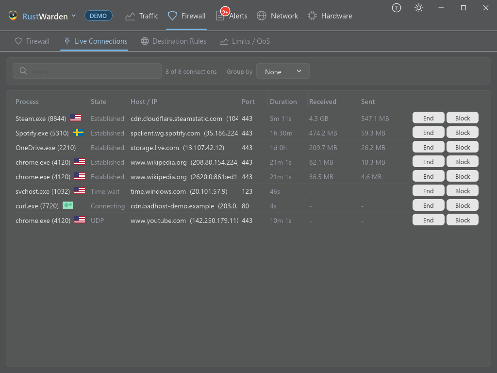

# Live Connections

**Firewall > Live Connections**

Every TCP connection open right now, with the program that owns it.

## The table

| Column | Meaning |
|---|---|
| **Process** | Program name and PID, followed by the remote country's flag |
| **State** | Established, Listening, Time-wait and so on |
| **Host / IP** | The remote host name (from the [DNS log](../network/dns-log.md), or from the driver in Driver mode) or the IP address |
| **Port** | The remote port |
| **Duration** | How long the connection has been open |
| **Received / Sent** | Bytes transferred. Counting starts when RustWarden first sees the connection. |

- Click a column header to sort by it, and again to reverse.
- **Group by** Process, State or Country gives collapsible groups.
- The search box filters on every column.

## Actions

| Button | What it does |
|---|---|
| **End** | Closes the connection. IPv4 only, because Windows has no way to close an IPv6 connection from outside. |
| **Block** | Blocks the remote address **in both directions** with a RustWarden firewall rule. **Restore firewall defaults** removes it. |

Byte counts and both buttons need administrator rights.

## Driver mode extras

With [Driver mode](../driver-mode.md) on and the driver installed:

- **UDP flows** (QUIC, voice, games) seen by the driver are listed too. Because UDP has no connection to close, **End** on a UDP flow drops its packets for **60 seconds**.
- **Packet capture.** Right-click a TCP connection and choose **Capture this connection to a .pcap file**. The driver copies that connection's packets, without holding any back, into a `.pcap` file that Wireshark can open, saved in the `captures` folder in RustWarden's data folder. A banner above the table shows the packet count and a **Stop** button. A capture also stops by itself at **50 MB or 5 minutes**. Encrypted connections stay encrypted in the file, because it holds the traffic as it crosses this PC.
- **More host names.** The driver reads the server name of new HTTPS connections (SNI) and DNS answers, so more rows show a name instead of a bare IP. See [Driver mode](../driver-mode.md#host-names).

## Demo mode

Demo mode shows sample connections. End and Block only say what they would do.
