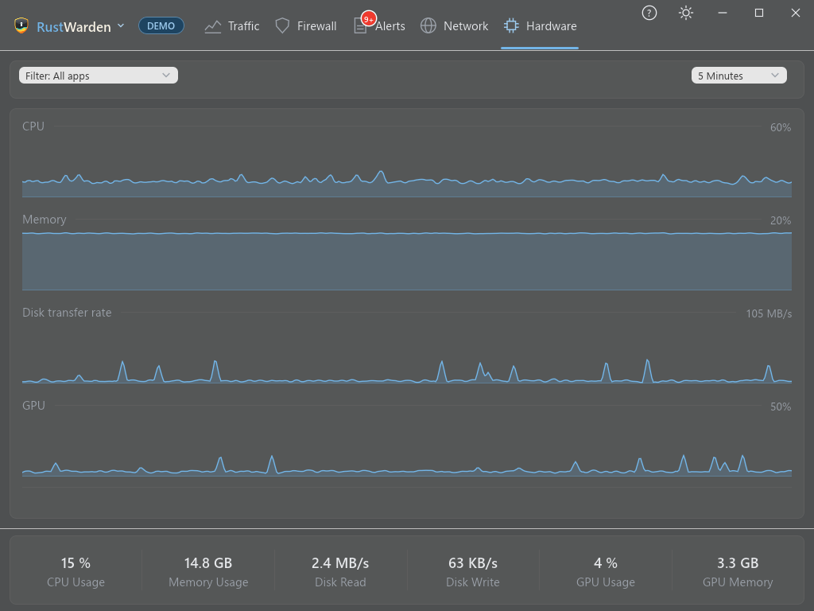

# Hardware

The **Hardware** tab charts your PC's resources over time:

- **CPU Usage**
- **Memory Usage**
- **Disk transfer rate** (read and write)
- **GPU Usage** and **GPU Memory**

Gaps, such as times when the PC was asleep or RustWarden wasn't running, are shown as gaps rather than joined up.

## Per-program view

Use **Filter: All apps** to choose one program and chart its own CPU, memory and disk use over time. It's useful for finding what was using the disk at 3 a.m.

## History

Live mode keeps hardware history for **Settings > General > History > Hardware history** hours (up to 30 days). Demo mode has sample history and programs.
