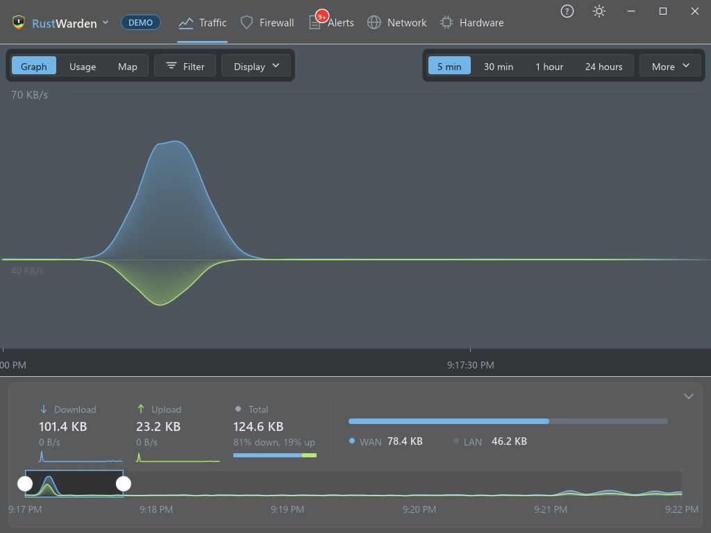

# RustWarden user guide

**See every connection. Block what you don't trust.**

RustWarden is a network monitor and firewall front-end for Windows 10 and 11. It shows which programs use the network, where their traffic goes and how much they send. You can allow, block or be asked about each program, and the rules go into the Windows Firewall you already have. It comes as one small `.exe`, needs no driver, and can sit in the system tray.

*Most screenshots in this guide come from Demo mode, which shows made-up data.*

## Where to start

-   **New to RustWarden?**

    ---

    Download it, run it and get through the setup wizard.

    [:octicons-arrow-right-24: Installing and first run](getting-started/install.md)

-   **Get to know the app**

    ---

    Live and Demo mode, Normal and Driver mode, administrator rights, and how the window is laid out.

    [:octicons-arrow-right-24: Key ideas](getting-started/concepts.md) · [The window](getting-started/interface.md)

-   **Take control**

    ---

    Firewall modes, blocking programs, destination rules and bandwidth limits.

    [:octicons-arrow-right-24: The Firewall tab](firewall/index.md)

-   **Locked out?**

    ---

    One command removes every rule RustWarden has made.

    [:octicons-arrow-right-24: Rescue](firewall/rescue.md)

## What RustWarden does

| Area | What you get | Guide |
|---|---|---|
| **See** | A live traffic graph and world map per app, live connections, a DNS log, a network scanner, and hardware history | [Traffic](traffic.md), [Network](network/scanner.md), [Hardware](hardware.md) |
| **Control** | Allow, block or Prompt per program, destination rules, upload and download limits, rulesets, a VPN kill switch | [Firewall](firewall/index.md), [Privacy & VPN](protection/privacy-vpn.md) |
| **Be warned** | More than 35 alert types, alert rules, malicious IP and domain lists, VirusTotal, beaconing and DNS tunnelling detection, a behaviour baseline | [Alerts](alerts/index.md), [Protection](protection/malicious-ip.md) |
| **Budget** | A data plan and per-app quotas that can warn, slow or block | [Data plan and quotas](protection/quotas.md) |
| **Extend** | Built-in plugins (Home Assistant, Speedtest, Ping Monitor, VirusTotal, notifications and more) and sandboxed third-party plugins | [Plugins](plugins/index.md) |

## Built to be safe

- **Local first.** Nothing that goes online is switched on until you turn it on yourself: lookups, threat lists, database downloads, notifications and so on. Tokens, API keys and webhook addresses are encrypted for your Windows account with Windows DPAPI.
- **Reversible.** Every firewall rule and QoS policy RustWarden creates is tagged as its own. One button (**Restore firewall defaults**) or one command (`RustWarden.exe --remove-all-rules`) removes them all, and rules made by Windows or other programs are never touched.
- **Try before you trust.** Demo mode runs every feature on made-up data and doesn't touch your system.

!!! tip "Try it in Demo mode first"
    RustWarden is a young project. Before you use the firewall features on your real PC, try them in Demo mode (**Settings > Other > General > Use demo data**), and remember where the [rescue command](firewall/rescue.md) is.
