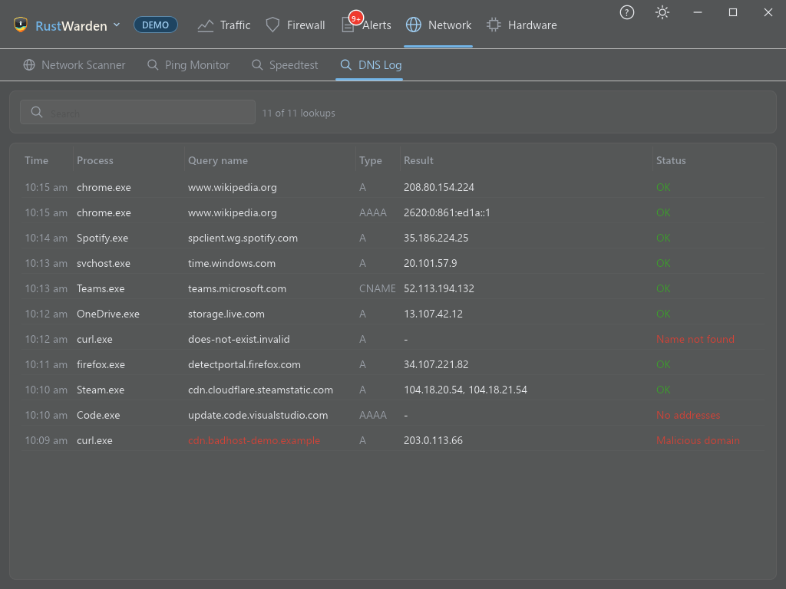

# DNS Log

**Network > DNS Log**

Every DNS lookup each program makes: which names it asked for, and what came back.

## The table

| Column | Meaning |
|---|---|
| **Time** | When the lookup happened |
| **Process** | The program that asked |
| **Query name** | The name looked up, for example `www.example.com` |
| **Type** | A, AAAA, CNAME, HTTPS and so on |
| **Result** | The addresses returned |
| **Status** | Success, or why it failed, for example "Name not found" |

The search box filters across all columns. Names on a [malicious-domain list](../protection/malicious-ip.md#malicious-domains) show in **red**.

## How it works

The log is read from the Windows DNS Client's own event tracing (ETW). Your DNS settings aren't changed in any way, and nothing leaves your PC.

- It needs **Live mode with administrator rights**.
- Programs that resolve names **themselves**, such as browsers using DNS-over-HTTPS, don't appear, because they bypass the Windows DNS Client. Two ways to see them anyway:
    - [Block DNS-over-HTTPS resolvers](../protection/privacy-vpn.md#block-dns-over-https-resolvers), so browsers fall back to the system resolver.
    - In [Driver mode](../driver-mode.md#host-names), the driver reads DNS answers directly and also logs lookups made by programs with their own resolver. Windows' own resolver is already logged, so those lookups aren't doubled.

## Settings

**Settings > General > History**:

- **DNS log** turns logging on or off.
- **DNS log history** sets how long it's kept (7 days by default).

Programs you've hidden under **Settings > Privacy** are left out of the log.

## What uses the DNS log

- **Host names** in Live Connections and the Firewall tab's Hosts column
- [Destination rules](../firewall/destination-rules.md) for domains, which learn a domain's addresses from your lookups
- [Malicious domain alerts](../protection/malicious-ip.md#malicious-domains)
- [DNS tunnelling detection](../alerts/alert-types.md#dns-tunnelling-detection)
- The [peer-to-peer guard](../protection/privacy-vpn.md#peer-to-peer-guard), which looks for traffic to addresses no lookup ever named
