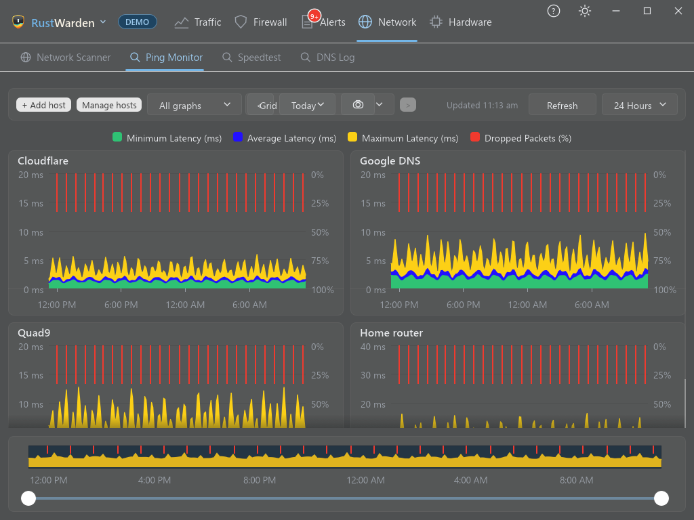
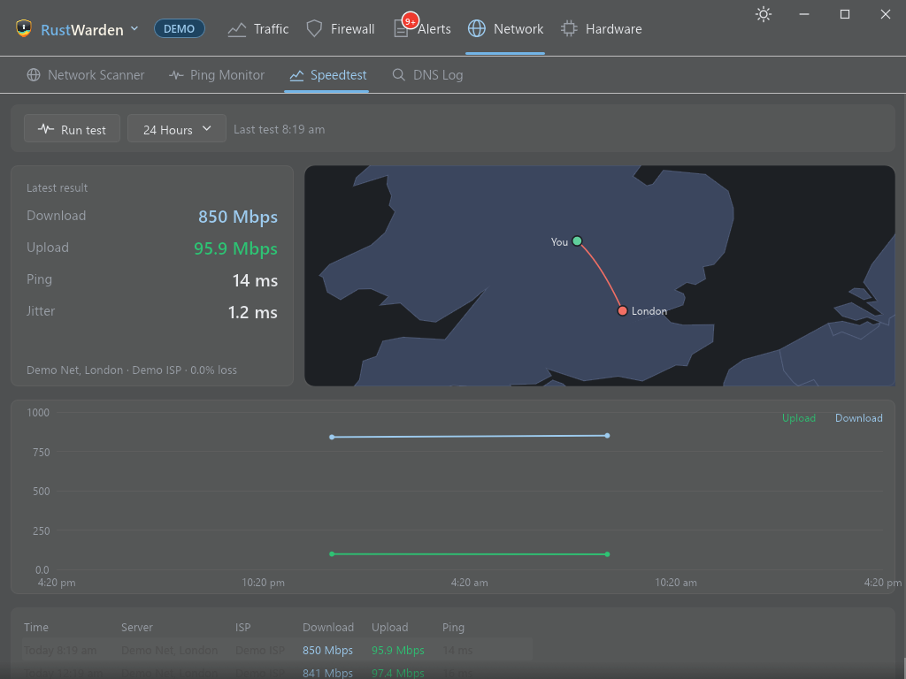

# Ping Monitor and Speedtest

Both are built-in [plugins](../plugins/index.md). Switch them on in **Settings > Plugins** and each adds a sub-tab under **Network**.

## Ping Monitor

**Network > Ping Monitor**

Keeps an eye on the latency and packet loss of hosts you care about: your router, your ISP's DNS, a game server, a website.

### Adding hosts

Press **Add host** and enter a host name or IP address, with an optional label. **Manage hosts** renames or removes them, and **Ping the hosts now** runs a round straight away.

Each host is pinged **every 30 seconds with three echoes**. RustWarden records the minimum, average and maximum latency and the packet loss.

### Charts

- Latency charts with a choice of time ranges.
- **Side by side**, **stacked** or **grid** layouts.
- History is kept for **30 days** in RustWarden's own database.
- Ping averages are also part of the [weekly report](../alerts/index.md#weekly-report).

Ping data is collected in Live mode. Demo mode shows sample charts.

## Speedtest

**Network > Speedtest**

Measures your internet connection's **download**, **upload**, **ping** and **jitter**.

### First use

Speedtest.net has no public API, so RustWarden uses Ookla's own `speedtest-cli`. The first time you press **Run test**:

1. A dialog explains that RustWarden will download Ookla's CLI and accept **Ookla's licence and GDPR terms** on your behalf. Only continue if you agree.
2. The CLI is downloaded from `install.speedtest.net` and checked against a pinned SHA-256.
3. When running as administrator, it's kept in `C:\Program Files\RustWarden\speedtest`; otherwise in the data folder.

Nothing is downloaded until you press the button.

### Running a test

While a test runs:

- a **speedometer** swings with the live speed, download then upload;
- a **graph** draws the speed over time;
- a **map** draws a line from you to the test server. This needs a GeoIP database, and a city database is the most exact. Without one, the map says the location is unknown. See [Countries](../protection/countries.md).

Results are added to a **history chart** and a **list of past tests**.

### Settings

In **Settings > Plugins > Speedtest > Settings**:

- **Server ID**: `0` lets Speedtest pick the closest server.
- **Automatic speed tests**: minutes between tests. `0` (the default) means only when you press **Run test**.

### Removing it

**Settings > Other > Backup > Clean up** deletes `speedtest-cli` and switches the plugin off. See [Clean up](../maintenance.md#clean-up).

Demo mode animates a made-up test.
