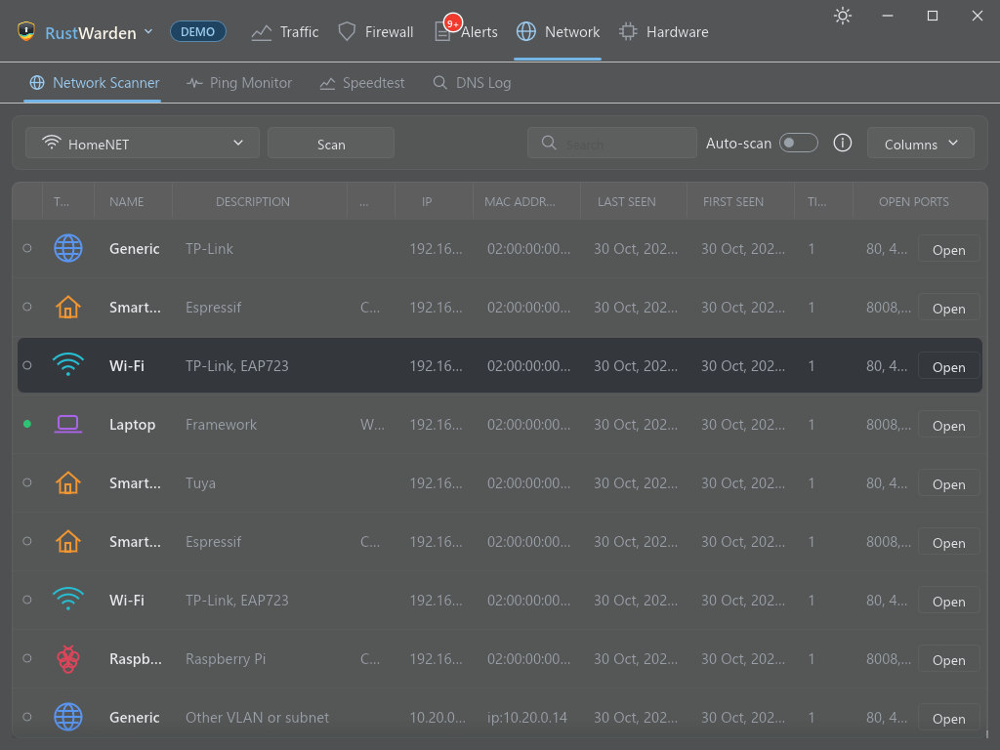

# Network Scanner

**Network > Network Scanner**

The scanner finds the devices on your local network (phones, TVs, printers, smart plugs, other PCs) and keeps a history of them.

## How scanning works

RustWarden reads this computer's ARP table, then probes the addresses of your own local subnet at a limited pace. Names come from reverse DNS (and NetBIOS / SSDP where devices answer), and vendors come from the MAC address. A device that doesn't answer shows as offline. The **(i)** button on the tab explains this too.

Scanning doesn't need administrator rights.

## The device list

| Column | Meaning |
|---|---|
| **Type** | Phone, printer, PC and so on, where it can be guessed |
| **HA** | The Home Assistant device-type icon, when the [plugin](../plugins/built-in.md#home-assistant) matches the device |
| **Name** | Reverse-DNS or device name, your own name for it, or its Home Assistant name |
| **Description** | The maker (from the MAC address) and any other description found |
| **System** | The operating system, where it can be told |
| **IP** / **MAC Address** | Its addresses |
| **Last Seen** / **First Seen** | When it was most recently and first found |
| **Times Seen** | How often it came back online |
| **Open ports** | From a port scan of that device |

- Click a column header to sort. Drag the borders to resize. **Columns** shows or hides columns. The layout is remembered.
- If you use more than one network (home, work), choose which one to view. **Forget network** deletes a network's history.

## Device details

Click a device for its details dialog:

- status, addresses, vendor and open ports
- **Rename**: give it your own name
- **Trusted (a known device)**: it won't raise a "new device" alert again
- **Port scan**: checks the device for common open ports. Results are saved.
- **Open**: a menu of services found on the device, such as its web page (HTTP/HTTPS), Remote Desktop, file sharing, a printer page, an RTSP stream or Plex. Choose one to open it.

## Scanning automatically

Switch on **Auto-scan** on the tab, or go to **Settings > Network Scanner**:

| Setting | Meaning |
|---|---|
| **Scan automatically** | Repeat scans in the background |
| **Time between scans** | Minutes between automatic scans |
| **Time between probes** | Milliseconds between probes. Raise it to be gentler on a slow network. |
| **Scan other VLANs and subnets** | See below |

### Other VLANs and subnets

ARP can't cross a router, so devices on other subnets (a guest Wi-Fi, an IoT VLAN) are invisible to a normal scan. With **Scan other VLANs and subnets** on (it's on by default), the scan also:

1. pings the `.1` and `.254` of each `/24` network in your `/16` (and, on `10.x`, the first `/24` of every `10.x` `/16`), then
2. pings every host in the networks that answered.

Devices found this way show **"Other VLAN or subnet"** instead of a vendor and are identified by IP, not MAC. Hosts that block ping aren't found, and scans take longer. Switch it off for a local-only scan.

## Scanner alerts

The scanner feeds three [alert types](../alerts/alert-types.md#your-local-network-network-scanner), each with its own switch:

- **New device**: a device never seen before joined the network.
- **Spoofing**: an IP changed MAC, or one MAC answers for several IPs. A gateway change is always Important.
- **Device returned**: a known device came back after N days away.

The first scan of a network only learns what's there, so you won't get a flood of "new device" alerts.

## Home Assistant

With the [Home Assistant plugin](../plugins/built-in.md#home-assistant), scanned devices are matched to your Home Assistant devices by MAC address. They then show their HA name, area and a coloured device-type icon, with a link to the device's page in Home Assistant.

## Demo mode

Demo mode shows a sample network.
