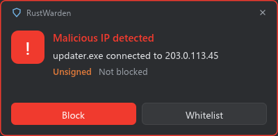

# Malicious IP and domain protection

**Settings > Malicious IPs**

RustWarden can download public threat lists and warn you, or block, when a program talks to an address or looks up a domain on them. Both features are **off by default because they download lists**.

## Malicious IPs

**Settings > Malicious IPs > IP lists**

| Setting | Meaning |
|---|---|
| **Warn about malicious IPs** | Turn the feature on. The lists below are downloaded. |
| **Block those addresses automatically** | Also block a listed address the moment a program connects to it |
| **Update the lists** | Hours between list updates (24 by default) |
| **Blocklist URLs** | One per line. The defaults are [Feodo Tracker](https://feodotracker.abuse.ch/) (botnet C2 servers) and [IPsum](https://github.com/stamparm/ipsum) level 3. |

When a program connects to a listed address, a **red popup** appears with the program, the address and buttons to **Block**, **Unblock** or **Whitelist**. The [Malicious IP protection](../alerts/alert-types.md#malicious-ip-protection) alert is recorded as well.

### Blocked & whitelisted

**Settings > Malicious IPs > Blocked & whitelisted** lists:

- **Blocked addresses**, with **Unblock** and **Whitelist**. After unblocking, the next connection raises a new warning but isn't blocked automatically.
- **Whitelisted addresses**, which are never warned about or blocked. **Remove** takes an address off the whitelist.

**Details** shows the whois record and which list an address came from.

### Never blocked

Whatever a list says, RustWarden never blocks:

- loopback and your local network,
- your gateways and DNS servers,
- your Home Assistant host.

They're left out, and the skip is logged.

### List safety checks

Each downloaded list is checked before it's used:

- **https only**, at most **20 MB**;
- refused if it's binary, a web page, mostly not entries, or over its size limit (200 000 addresses, 1 000 000 domains);
- if a list is refused or fails to download, the addresses from its **last good copy** are kept;
- the cache is replaced in one step, and the previous copy is kept as a backup.

Skipped and refused lists are written to `%LOCALAPPDATA%\RustWarden\lists.log`.

## Malicious domains

**Settings > Malicious IPs > Domain lists**

| Setting | Meaning |
|---|---|
| **Warn about malicious domains** | Turn the feature on. The lists below are downloaded. |
| **Update the lists** | Hours between list updates |
| **Domain list URLs** | Hosts files or plain name lists, one URL per line. The default is a keyless mirror of [abuse.ch URLhaus](https://urlhaus.abuse.ch/). |

When a program looks up a listed name, or a subdomain of one, a [Malicious domain](../alerts/alert-types.md#malicious-domain-alerts) alert is raised once, and the name shows in **red** in the [DNS log](../network/dns-log.md).

This **only warns**: nothing is blocked, and your DNS settings are never changed. It needs the DNS log. To actually block domains, see [Destination rules](../firewall/destination-rules.md) or [Block by domain](../firewall/destination-rules.md#block-by-domain-driver-mode).

## Demo mode

The lists are Live-only. Demo mode downloads nothing.
