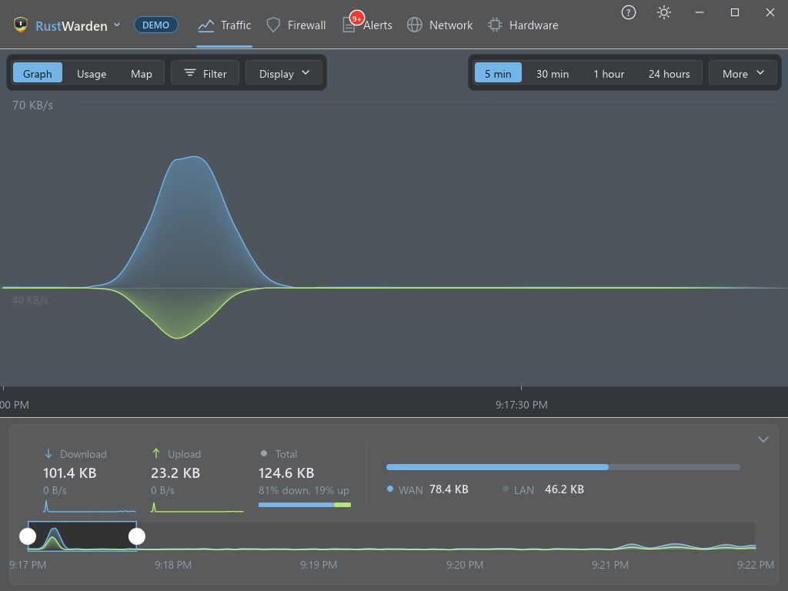
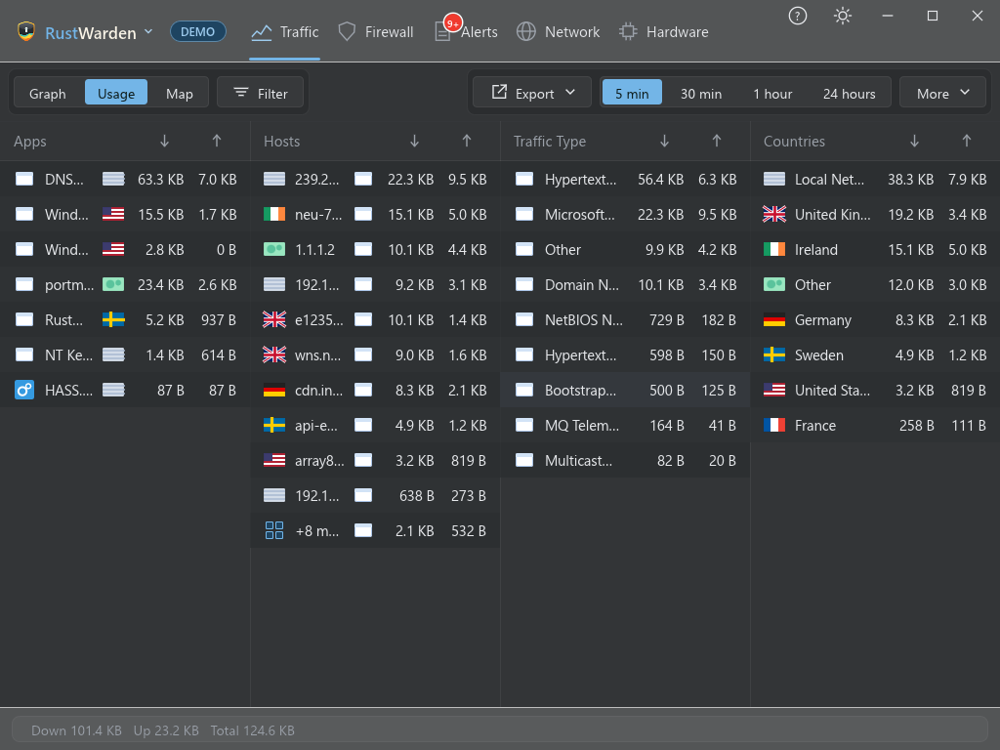

# Traffic

The **Traffic** tab shows how much data each program sends and receives, and where it goes. It has three views, chosen with the **Graph / Usage / Map** switch at the top left.

!!! note "Live mode needs administrator rights"
    Per-program traffic comes from Windows event tracing (ETW), which needs administrator rights. Without them, the tab says so and offers a restart as administrator.

## Common controls

### Time range

The chips at the top right choose how much time the view covers: **5 min**, **30 min**, **1 hour** and **24 hours**. **More** offers 1, 10 and 15 minutes and 3 hours. The range applies to all three views and is remembered.

### Filter

**Filter** opens a panel that narrows **every** view at once. When a filter is active, a dot appears on the button.

| Filter | Choices |
|---|---|
| Direction | Download, upload or both |
| Scope | Internet, local network or both |
| App | One program, or all apps |
| Company or ASN | Only remote hosts belonging to a company or AS number, for example `google` or `15169`. This needs the [AS lookup](protection/countries.md#as-number-and-company) to be switched on. |

## Graph view

- **Download** is drawn above a centre line and **upload** below it, stacked by program.
- Under the graph, the **Download**, **Upload** and **Total** blocks and a **WAN/LAN split bar** sum up the period.
- A **timeline brush** over the stored history lets you pick the span to look at.
- The arrow folds the totals and timeline down to a compact bar, and remembers that.
- Hover over the graph to see the rate at that moment. Click a program to open its details.

### Alert pins

Alerts appear as **pins** on the graph at the moment they happened. Orange pins are Important alerts, and purple pins are [behaviour baseline](protection/baseline.md) alerts. Click a pin for the details. On a baseline pin you can press **Mark as normal** to teach the baseline.

Use **Display** (Graph view only) to choose which alert types get pins.

## Usage view

A table of every program with its download, upload and total for the selected range. Click a column to sort by it, and click a program for its hosts, countries and details.

- **Export** saves the table as a CSV file, which opens in Excel.
- **History** saves the last 30 days of per-app traffic. Give the file a `.json` name for JSON; any other name gives CSV.

Both are written only when you click them, and only to a file you choose.

## Map view

An interactive world map with a bubble per country, sized by traffic.

- Nearby bubbles **cluster** when you zoom out and split apart when you zoom in. Scroll to zoom, drag to pan.
- Hover a country to tint it, and click a bubble for a detail popup: programs, hosts and amounts.
- The **Home** marker is your own location. Click the Home key beside the range chips to centre on it.
- **Display** switches country names, flags, animated traffic lines, and allowed or blocked traffic on and off. **Red dashed lines are blocked attempts.**

The map needs the country database, and the **city database** to place connections at their city rather than the middle of the country. See [Countries and lookups](protection/countries.md).

## Program details

Clicking a program anywhere on the Traffic tab opens its info popup, the same one the [Firewall tab](firewall/index.md#the-app-info-popup) uses. It shows path, version, publisher, signature, quota use, the service and parent process that started it, and its alert history.

## Windows services

Many Windows services share one `svchost.exe` process. RustWarden splits that traffic by the service that sent it, so you see for example **Windows Update (wuauserv)** instead of one big `svchost.exe` row. The app info popup shows the service and the parent process that started each program.

## Kernel & System split

Windows reports all networking done inside the kernel as one program, **"NT Kernel & System"**. RustWarden splits that row by service, told apart by port:

- **SMB file sharing**
- **NetBIOS**
- **Device discovery**
- **HTTP.sys listeners**
- **Other**

Each row has its own remote hosts. Windows doesn't say which driver or app caused kernel traffic, so the port is the only evidence. Like the original row, these rows can't be blocked.

It's on by default. Turn it off in **Settings > General > General > Split "NT Kernel & System" by service**. It applies to new traffic only and needs administrator rights.

## VPN traffic

A VPN client's own encrypted traffic duplicates everything your apps send through it, so it would always top the list. **Settings > Privacy > VPN > Don't count VPN tunnel traffic while a VPN is connected** leaves it out; your apps' own traffic is still counted. Common VPN clients are recognised, and you can add others by executable name. See [Privacy and VPN](protection/privacy-vpn.md).

## History and retention

Live mode keeps traffic history in a local database for **Settings > General > History > Traffic history** days. **Clear traffic history…** on the same page deletes it; alerts, apps and devices are kept. Demo mode keeps no history.
